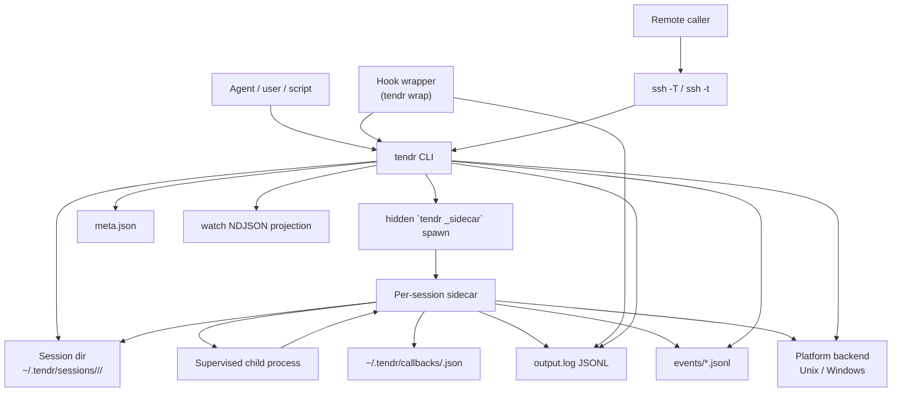

# System Context

Tendr has two kinds of process: a short-lived CLI and one sidecar per run.
The CLI creates or queries sessions, writes control requests, and exits. The
sidecar owns the child process and captures its output. When a sidecar is
gone, the CLI's reconciliation step records what happened (see
[03-run-lifecycle.md](03-run-lifecycle.md)).

Who does what:

- **CLI.** Parses arguments, resolves namespaces, writes control requests, and
  reads persisted state. It exits when the command is done.
- **Sidecar.** Holds the session lock, spawns the child, writes run-state
  transitions, captures output, and classifies the exit. It is the normal
  writer of lifecycle state. CLI reconciliation is the one exception.
- **Session record.** Three files or folders hold the facts:
  - `meta.json`: the current run snapshot.
  - `output.log`: child output.
  - `events/*.jsonl`: lifecycle and provenance history.
- **SSH.** `--host` runs the same tendr binary on another host for the
  remote-capable commands, sending each request as data on ssh stdin
  ([06-transport-boundaries.md](06-transport-boundaries.md#ssh-transport)).
  It adds no second lifecycle model.

Covered elsewhere:

- session file names: [02-session-storage.md](02-session-storage.md)
- state transitions: [03-run-lifecycle.md](03-run-lifecycle.md)
