# Session Storage

Tendr keeps its state under `~/.tendr/`, where `~` is `HOME`, or on Windows,
when `HOME` is unset (as in an OpenSSH session), `USERPROFILE`. Each session
has one directory, `~/.tendr/sessions/<namespace>/<session>/`. Some files are
the durable record. Others are short-lived control files, or exist only for
one kind of session.

```mermaid
flowchart TD
    Root["~/.tendr/"] --> Sessions["sessions/"]
    Root --> Callbacks["callbacks/<run_id>.json\n--on-exit results"]
    Root --> Sockets["sockets/<hash>.sock\nPTY attach sockets"]
    Root --> LostFound["lost+found/events.jsonl\nEvents with no session dir"]

    Sessions --> Namespace["<namespace>/"]
    Namespace --> Session["<session>/"]

    Session --> Meta["meta.json\nCurrent run snapshot"]
    Session --> Lock["lock\nSession ownership"]
    Session --> Log["output.log\nJSONL stdout/stderr/annotations"]
    Session --> Events["events/<uuidv7>.jsonl\nLifecycle and provenance history"]
    Session --> EventBlobs["events/blobs/<sha256>\nSpilled event payloads"]
    Session --> EventLock["events/append.lock\nAppend lock (Unix)"]
    Session --> Recording["recording/<run_id>/seg-<index>.tndrrec\nPTY recording"]

    Session --> Launch["launch_spec.json\nCLI to sidecar handoff"]
    Session --> Generation["generation\nReplace hint"]
    Session --> ChildPid["child_pid\nOrphan breadcrumb"]

    Session --> Stdin["stdin.pipe\nOnly with --stdin (Unix FIFO)"]
    Session --> ExecLock["exec.lock\nExec serialization"]
    Session --> ExecResults["exec-results/<token>.json\nPython REPL and PowerShell exec"]

    Session --> KillReq["kill_request\nKill control file"]
    Session --> KillMarks["kill_forced / kill_acted\nKill classification"]

    Session --> AttachPath["a.sock.path\nPTY only: path of the attach socket"]
```

Each fact has one home (rule 4 in
[../design.md](../design.md#4-durable-truth-derived-views)):

- `meta.json` is the current run snapshot.
- `output.log` is the child-output record.
- `events/*.jsonl` is lifecycle and provenance history.

`status`, `list`, `log`, `watch`, `events` and `query` read these files. They
create no state of their own.

## Durable files

| Path | Written by | Notes |
|---|---|---|
| `meta.json` | sidecar; CLI reconciliation | Written to `meta.json.tmp`, then renamed. |
| `output.log` | sidecar; `wrap`; `exec` | Append-only JSONL. See tags below. |
| `events/<uuidv7>.jsonl` | sidecar; `emit`; `exec`; `wrap`; reconciliation | Append-only. Format: [07-event-protocol.md](07-event-protocol.md). |
| `events/blobs/<sha256>` | any event writer | Payloads over 16 KiB, keyed by SHA-256. |
| `recording/<run_id>/seg-<index:08>.tndrrec` | sidecar (PTY sessions) | Directories `0700`, segments `0600` on Unix. Format: [08-pty-recording-format.md](08-pty-recording-format.md). |
| `~/.tendr/callbacks/<run_id>.json` | sidecar | `--on-exit` results. Outside the session dir, so it survives `--replace`. |
| `~/.tendr/lost+found/events.jsonl` | `emit`; sidecar | Events whose session dir was gone or whose event log was unwritable. |

`output.log` line tags:

| Tag | Content |
|---|---|
| `O` | stdout, or the merged PTY output |
| `E` | stderr (pipe sessions only) |
| `A` | annotations written by `wrap` and `exec` |

## Control files

These files carry one request or hint between processes. Most are removed
once used.

| Path | Purpose | Lifetime |
|---|---|---|
| `lock` | Held by the sidecar for the whole run; reconciliation takes it once the sidecar is gone. | Stays; only the lock matters. |
| `launch_spec.json` | The launch request from `start` to the sidecar. | The sidecar deletes it after reading. |
| `generation` | The next generation number after `--replace`. | The sidecar deletes it after reading. |
| `child_pid` | Child identity, written right after spawn, for crash recovery. | Removed once the exit is recorded. |
| `kill_request` (via `kill_request.tmp`) | A kill request with `force` and `run_id`. | Removed when the run ends. |
| `kill_forced` | Written by `kill --force` before it signals. | Removed when the run ends. |
| `kill_acted` | Written by the sidecar when it acts on a graceful kill. | Removed when the run ends. |
| `stdin.pipe` | Unix FIFO for `push` and `exec`. Windows uses a named pipe outside the session dir. | Removed when the run ends. |
| `exec.lock` | Serializes `exec` calls on one session. | Stays; only the lock matters. |
| `exec-results/<token>.json` | Result file for a Python REPL or PowerShell exec. | `exec` deletes it after reading. |
| `events/append.lock` | Unix advisory lock for event appends. | Stays; only the lock matters. |
| `a.sock.path` (via `a.sock.path.tmp`) | Path of the PTY attach socket. | Removed with the socket when the run ends. |

## PTY attach socket

The attach socket is not in the session dir. It is
`~/.tendr/sockets/<name>.sock`, where `<name>` is 12 hex characters of a
SHA-256 over the session path and run ID (`src/attach_socket.rs`). The
`sockets/` directory is owner-only (`0700`) and the socket is `0600`.

One state root serves one account. `~/.tendr` must be owned by the user who
runs tendr, and only that user may write it: binding an attach socket refuses a
root owned by anyone else, and removes group and other write permission from
the user's own root, with a run warning. Sharing a state root between accounts
is not supported.
`a.sock.path` in the session dir holds the socket's full path.

Covered elsewhere:

- the run state machine inside `meta.json`: [03-run-lifecycle.md](03-run-lifecycle.md)
- how `stdin.pipe`, `kill_request` and the attach socket are used:
  [05-key-flows.md](05-key-flows.md) and [04-pty-lane.md](04-pty-lane.md)
