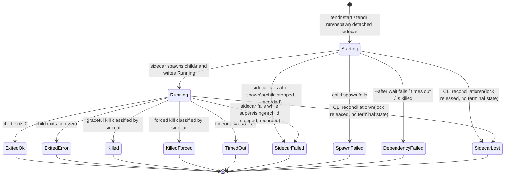

# Run Lifecycle

Tendr models supervised runs, not raw processes. The sidecar is the normal
writer of lifecycle state. The CLI writes lifecycle state only during
reconciliation, in two cases:

- It infers `SidecarLost`: the lock is released and no terminal state was
  written.
- It *heals* a terminal state (`Exited*`, `SpawnFailed` or
  `DependencyFailed`). The sidecar appended the terminal event, then died
  before it wrote `meta.json`. Reconciliation copies that event into meta.

**The invariant.** Once the child is spawned, one of three things is true:

1. The sidecar is alive and owns the child.
2. Meta is terminal and the child is dead.
3. The sidecar died by a true crash, and the next reconciliation reaches
   state 2.

No child is left running without a supervisor and without a record. A true
crash is anything that ends the sidecar without unwinding: SIGKILL, OOM,
`abort`, and any signal it does not handle. SIGTERM, SIGINT and SIGHUP are
among those. The one gap is listed under [Limits](#limits).



In `meta.json`, `status` is one of `Starting`, `Running`, `SpawnFailed`,
`Exited`, `SidecarLost` or `DependencyFailed`. An `Exited` status carries a
`reason`: `ExitedOk`, `ExitedError`, `Killed`, `KilledForced`, `TimedOut` or
`SidecarFailed` (`src/model/state.rs`). Transitions are checked at runtime in
`src/model/transition.rs`.

## Who writes each transition

This follows rule 2, one authority per fact, in
[../design.md](../design.md#2-one-authority-per-fact).

The sidecar writes:

- `Starting -> Running`
- `Starting -> SpawnFailed`
- `Starting -> DependencyFailed`
- `Running -> Exited*`: `ExitedOk`, `ExitedError`, `Killed`, `KilledForced`,
  `TimedOut`
- `Starting | Running -> SidecarFailed`: the sidecar's own record that it
  failed while supervising. It is an `Exited` reason, so meta keeps the
  child identity.

CLI reconciliation writes the rest. It runs in `status`, `wait` and
foreground `run`:

- `SidecarLost`, when the lock is released with no terminal state. If the
  lost sidecar's child is still alive, reconciliation kills it first (see
  [True crashes](#true-crashes-reconciliation-kills-the-orphan)).
  A PTY recording still marked `Recording` is marked `Stopped` with reason
  `sidecar_lost` and no last sequence, and a `recording.stopped` event is
  logged before `run.sidecar_lost`.
- A healed terminal state, copied from the sidecar's own terminal event. The
  sidecar's observation and provenance are kept, not re-derived. The
  recorder finished before that event, so a PTY recording still marked
  `Recording` is complete: it is marked `Stopped` with reason
  `end_unrecorded` and no last sequence, in `meta.json` only. No event is
  logged, as a `recording.stopped` would follow the run's terminal event.

## Transition provenance

Every transition after `Starting` sets `transition_provenance` in
`meta.json` (`src/model/provenance.rs`). It describes the latest transition
only; the event log holds the full history.

```json
"transition_provenance": {"kind": "direct", "evidence": ["sidecar_write", "child_exit_observed"]}
```

`kind` is `direct` when the sidecar recorded what it observed. It is
`inferred` when reconciliation concluded the transition from indirect
evidence. A `Starting` meta has no `transition_provenance`.

| Transition | `kind` | `evidence` |
|---|---|---|
| `Running` | `direct` | `sidecar_write`, `child_spawned` |
| `SpawnFailed` | `direct` | `sidecar_write`, then `spawn_failed_syscall`, or `attach_socket_failed` when a PTY session's attach socket could not be bound (nothing was spawned) |
| `Exited` (child exit, kill, timeout) | `direct` | `sidecar_write`, `child_exit_observed` |
| `Exited` with `SidecarFailed` | `direct` | `sidecar_write`, `supervision_failed` |
| `DependencyFailed` | `direct` | `sidecar_write`, `dependency_failed` |
| `SidecarLost` | `inferred` | `lock_released`, `non_terminal_meta`, plus `orphan_killed` if it killed the child |
| healed terminal state | `direct` | `event_log_terminal`, plus `orphan_killed` for a healed `SidecarFailed` whose child it killed |

Lifecycle events carry the same `kind` as `data.provenance` (`"direct"` or
`"inferred"`); see [07-event-protocol.md](07-event-protocol.md).

## Dependency wait (`start --after`)

The dependency wait happens while the run is in `Starting`. Before it starts,
the sidecar writes `Starting` to `meta.json`. It then scans every dependency
once, before it signals readiness to `start` (`first_dependency_scan` in
`src/sidecar.rs`). So when `start` returns, either every dependency has been
inspected once, or a terminal state was written first.

The first scan has three outcomes:

| Outcome | What happens |
|---|---|
| Every dependency already satisfied | Signal readiness, then spawn at once. |
| Some pending, none failed | Signal readiness with `Starting`, then poll every 500 ms. |
| A dependency failed, the timeout passed, or a kill request arrived | Write `DependencyFailed` to meta, then signal readiness with that snapshot. |

A satisfied dependency is *latched* to the `run_id` it was observed at and is
never inspected again. One deadline, set before the first scan, covers the
whole wait.

Each dependency is bound to `(session, run_id)`. If a pending dependency is
replaced with `--replace`, the waiter fails. It never follows a different
run. By default a dependency is satisfied only by `ExitedOk`; `--any-exit`
accepts any terminal state.

## The lifecycle guard

In the sidecar, a `SupervisedRun` (`src/sidecar/supervised_run.rs`) owns the
child from the moment it is spawned. It also owns the kill handle, meta, the
event writer, the session lock, any readiness still owed to the `start`
client, and, for a PTY session, the attach socket.

A PTY session's attach socket is bound, and `a.sock.path` written, *before*
the child is spawned. So a PTY session never runs without its listener. A
bind failure there is `SpawnFailed`: no child exists yet, so the guard has
nothing to own. After spawn, the guard removes the socket and `a.sock.path`
on every exit, before it releases the session lock.

- `SupervisedRun<Spawned>::publish_running` is the only way to reach
  `SupervisedRun<Running>`. So everything `Running` promises exists before
  `Running` is published: the `--stdin` transport and, for a PTY session, its
  recorder, input writer and attach listener.
- `finish(reason)` is the only normal exit.
- Any other exit (an error, an early return, a panic unwinding) stops the
  run as a graceful `kill` would (see [Stopping a run](#stopping-a-run)),
  with a forced kill if the child has not exited after 10 s. On Unix the
  kill path is the child's process group; a PTY child leads its own
  session. On Windows it is the Job Object. The guard then records
  `Exited { reason: SidecarFailed { step } }`.
- The type parameter covers only the in-process guard. Persisted meta is
  still checked at runtime in `transition.rs`, because a type parameter does
  not survive serialization.

What a failed post-spawn step does:

| Step (`step`) | Action | Reason |
|---|---|---|
| readiness to the client (`readiness`), and the meta rewrite that records a lost delivery | recover, with a warning | Readiness only informs the client that asked; the run never depends on it. It is a `#[must_use]` value, not a `Result`. |
| `child_pid` breadcrumb (`breadcrumb`) | recover, with a warning | Only crash recovery reads it. |
| PTY I/O setup (`attach_bind`): the recorder, the input writer, and the listener on the socket bound before spawn | end the run | A PTY session never runs without its listener. The listener reaches the PTY only through the input writer. |
| `output.log` open (`output_log`) | recover: drain the output, warning `output not captured` | The exit is still worth recording, and a child that nobody reads blocks on a full pipe. |
| `output.log` write during the run (`output_log_write` in tests) | recover: stop logging that stream, keep reading and discard; one warning per stream, written to meta while the run is live | The child must never block on a full pipe, and its exit is still worth recording. |
| stdin transport (`stdin_transport`) | end the run | A `--stdin` run whose input can never arrive is a failed run. |
| publishing `Running` (`running_meta`) | end the run | `Running` must be observable. |
| observing the exit (`child_wait`) | end the run | An exit that cannot be observed cannot be classified. |
| terminal meta after a normal exit | not a kill: save a copy to lost+found, still run hooks | The durable terminal event lets reconciliation heal meta. |

A `SidecarFailed` run shows up in these places:

- meta: `"reason":"SidecarFailed","step":…` and a warning
  `sidecar failed at <step>: <error>`
- the event log: a durable `run.sidecar_failed` event
- exit code **5** from `wait`, `run` and `start`
- `--on-exit` hooks, run with `TENDR_EXIT_REASON=SidecarFailed`
- a `start` client still waiting, which receives the terminal snapshot

Exit code **3** (`SidecarLost`) means something else: the sidecar vanished,
so the child may still be running.

If the failure record itself cannot be written, the child is still stopped.
The failure is reported on the channels still open:

- a `start` client still waiting gets an `ERROR:` saying the record failed
- a copy of the record, with the write error, goes to
  `~/.tendr/lost+found/events.jsonl`
- the `child_pid` breadcrumb stays, so later recovery can find the child

## True crashes: reconciliation kills the orphan

The guard cannot run when the sidecar dies from an unhandled signal, OOM or
an abort. Reconciliation holds the session lock throughout and re-reads meta
under it. So a sidecar that wrote its terminal record just before releasing
the lock always wins.

When reconciliation infers `SidecarLost`, it looks for the child the sidecar
left behind:

- meta's `Running` child, or
- while meta is still `Starting` (the `--after` path), the `child_pid`
  breadcrumb.

It kills that child only if the process with that PID has the recorded start
time (`AliveVerified`). A reused PID is never killed. The kill is forced and
aimed at the process group, so `status` does not wait for a grace period.
The orphan-directory cleanup (below) uses the same identity rule.

The outcome is recorded:

- killed: `orphan_killed` evidence and a warning
- identity not verified, or the kill failed: a warning, and no kill
- child already gone: nothing

On Windows the child is in a kill-on-close Job Object that only the sidecar
holds. The kernel kills the process tree when the sidecar dies, so
reconciliation only records the loss.

If the sidecar's durable `run.sidecar_failed` event exists but its meta write
failed, reconciliation heals meta from that event. This also works on the
`--after` path, where meta was still `Starting`; the breadcrumb supplies the
child. The sidecar writes that event even when its forced kill did not take.
So the healed record's child gets the same identity-checked kill and the
same record: `orphan_killed` evidence beside `event_log_terminal` and a
warning when killed, a warning when it cannot be verified or killed, nothing
when it is already gone. No other healed record needs this check. An
observed exit means the sidecar reaped the child, and `SpawnFailed` or
`DependencyFailed` never had one.

## Stopping a run

`kill`, `kill --force` and `--timeout` stop the child first, then the rest
of the run (`Platform::stop_run` in `src/platform/`).

1. **The child's process group.** A graceful stop (`kill`, `--timeout`)
   sends SIGTERM to the group, and SIGKILL after 5 s if the child is still
   alive. A PTY child's group first gets SIGHUP and up to 1 s to act on it,
   as when a terminal window closes, so an interactive shell passes the
   hangup on to its jobs as it exits. `kill --force` sends SIGKILL at once.
2. **Every other process the run started (Linux and macOS).** Once the
   child has exited, or been sent SIGKILL, the sidecar searches for the rest
   of the run (below).
   - A graceful stop sends SIGTERM to each process found outside the
     child's group, which has had it already, then SIGCONT to all of them,
     so a stopped job can act on it, and gives them up to 1 s to exit.
   - Then each process left is sent SIGSTOP as it is found, so it cannot
     start more, and the search repeats until it finds nothing new; only
     then are they all sent SIGKILL. These rounds repeat until two in a row
     find nothing, for at most 5 s.
   - This reaches a job-control shell's jobs, `nohup` jobs, `setsid`
     processes, `(cmd &)` and `disown` jobs, and programs a child starts in
     sessions of their own, such as Claude Code's Bash tool shells, within
     the limits below.
   - A tendr session started from inside the run is a session of its own.
     The stop leaves its sidecar, found by its `_sidecar` argument, and
     everything below it alone.
   - Processes the stop could not signal, or that outlived its 5 s, are
     named in a run warning `stopping the run: processes the run started
     outlived the stop: pids …`.
3. **Then the end is recorded.** The run's end waits until a stop under way
   has finished. So a process the stop ended no longer holds the terminal
   or the output pipes, and capture ends with them. The `--on-exit` hooks
   run after the end, so a stop never reaches them.

How the search finds the run:

- **Linux.** Before it spawns the child, the sidecar makes itself a child
  subreaper (`PR_SET_CHILD_SUBREAPER`). Every process the run starts then
  stays a descendant of the sidecar, even after its own parent has exited.
  The sidecar reaps these orphans by pid while the run lasts, never with
  `waitpid(-1)`, which would race the wait for the child, and not while a
  stop is searching. The search lists the sidecar's descendants through
  `/proc/<sidecar>/task/*/children`; it ends only after two empty searches
  because the kernel may skip a child in a list that is changing as it is
  read.
- **macOS.** Orphans go to launchd, so the search looks at every process
  of the same user (`proc_listallpids`, `proc_pidinfo`) and takes:
  - those in the run's session (`getsid`): the child's for a PTY run; for a
    pipe run the sidecar's, which it leads, and taken only if it does;
  - the sidecar's descendants, by parent pid;
  - before the child is signalled only, those holding the run's terminal
    (`PROC_PIDLISTFDS`, then each vnode descriptor's device);
  - the descendants of all these.

  The child's exit as session leader revokes its terminal from every
  holder and leaves its own children to launchd, after which neither can
  be told apart from other processes. So the sidecar lists the run before
  it signals the child, and every later search also takes whatever of that
  list is still running with the same start time.

On Windows the child's Job Object holds the whole tree. A forced stop ends
it; after a graceful one the rest of the tree ends when the sidecar exits,
since only the sidecar holds the kill-on-close Job Object.

## Limits

- **Crash before the breadcrumb.** The sidecar may crash after spawning the
  child but before it writes `child_pid`, or after that write failed
  (recovered with a warning). While meta is absent or `Starting`,
  reconciliation then has nothing to find. On Windows the Job Object still
  kills the child.
- **What a stop does not touch.** A tendr session started from inside the
  run, with its whole tree (above).
- **What a stop cannot reach.** A stop ends only what it can find.
  - On Linux, it cannot reach:
    - processes started through another manager rather than as the run's
      descendants: `systemd-run --user`, D-Bus activation, `at`, or a
      server the run asks over a socket, such as a `tmux` or Docker server
      that was already running;
    - anything left after the sidecar itself died, since reconciliation
      kills only the child's process group (see
      [True crashes](#true-crashes-reconciliation-kills-the-orphan));
    - anything at all on a kernel built without `CONFIG_PROC_CHILDREN`,
      which has no children lists. The sidecar then does not adopt orphans
      either, and the run gets a warning `a stop may miss processes the
      child leaves behind`.

    It also cannot end a process this user may not signal, such as a
    setuid program, though it reaches that process's children. A process
    in uninterruptible sleep dies only once it wakes, which may be after
    the stop's 5 s. The run warning above names both kinds.
  - Adoption is visible: a process the run daemonises sees the sidecar as
    its parent (`getppid()`), not pid 1, while the run lasts.
  - On macOS, it cannot reach:
    - a process that left the run's session, has no parent left in the run
      and holds no terminal descriptor: a process that called setsid(2),
      was orphaned and has its output redirected. Claude Code's
      `(setsid tail -f /dev/null >/dev/null 2>&1 &)` is one on Linux; macOS
      has no `setsid` command, but a program can make the same call. Only
      the listing before the child is signalled looks for terminal
      holders, so such a process started after it is out of reach even if
      it holds the terminal;
    - processes started through launchd or another manager, or by a server
      the run asks over a socket;
    - anything left after the sidecar itself died.

    The search lists processes and then signals them, so a process can fork
    in between. Its child stays below the stopped parent, and the search
    repeats until it finds nothing new before it kills any of them, so the
    child is found. What escapes is a child whose parent exits on its own in
    that moment, if the child has also left the run's session: the first
    case above.
- **A terminal holder outlives a PTY child that exits on its own.** A
  process outside the child's session may still hold the terminal after the
  child has exited. Capture then reads what that process writes for at most
  2 s after the child's own output has been read, and ends. The sidecar
  reaps the child and records its exit, with a run warning `capture ended 2
  s after the child exited`. On Linux the warning names the pids that still
  hold the terminal, found through `/proc/*/fd`; processes of another user
  are missed. A terminal that has closed by the time the 2 s pass is read to
  its end, with no warning. The holder is left running; its later writes to
  the terminal fail once the sidecar has exited, and are not captured. A stop
  ends such a holder before the end is recorded, on Linux and on macOS, so
  the terminal closes and there is no warning. On macOS the child's exit
  revokes the terminal from every process, so capture ends with the child
  and there is no warning either.
- **An output holder keeps a pipe run going.** A pipe run's capture ends when
  its stdout and stderr pipes close. A process that inherited them and
  outlives the child keeps the run `Running`, with the child unreaped, until
  it exits. A stop ends it, on Linux and on macOS, and the run with it.
- **`kill` fails if the run does not end.** `kill` waits for the end to be
  recorded: by the sidecar, or by reconciliation once no sidecar holds the
  session (recorded as `SidecarLost`). If the sidecar holds the session but
  records no end within its wait (about 20 s), `kill` exits 1. The run may
  still end later.
- **Graceful stop.** `kill` without `--force`, and `--timeout`, escalate to
  SIGKILL on the group only while the child itself is alive. A timed-out
  child therefore exits up to about 6 s after the deadline, and the run is
  still recorded as `TimedOut`. The rest of the run then gets up to 1 s to
  exit on SIGTERM before SIGKILL, on Linux and on macOS.
- **Crash before any meta.** The sidecar may crash, or fail to record its
  failure, before any meta was written. The orphan-directory cleanup in
  `status` and `start` handles this. It kills the breadcrumb's child by the
  same identity rule and removes the directory without a record. The only
  copy of the failure record is then the lost+found one.
- **Descriptors opened while `start` lists them.** `close_range` exists from
  Linux 5.9, and its `CLOSE_RANGE_CLOEXEC` flag from 5.11. Where the call or
  the flag is missing (macOS, older Linux) or seccomp denies it, `start` lists
  its fds in `/dev/fd` before forking the sidecar. A non-close-on-exec fd
  another thread opens in that window would reach the sidecar. `start`'s own
  fds are all close-on-exec, so only a caller's leaked fd is at stake, and
  that is open before `start` runs. If `/dev/fd` cannot be read either,
  `start` marks every fd from 3 below the soft `RLIMIT_NOFILE`, capped at
  2^20. An fd above that bound, left from before the limit was lowered,
  would get through.

Covered elsewhere:

- PTY control, which is separate from the run lifecycle:
  [04-pty-lane.md](04-pty-lane.md)
- the OS-specific mechanics of kill, wait and process identity: `src/platform/`
