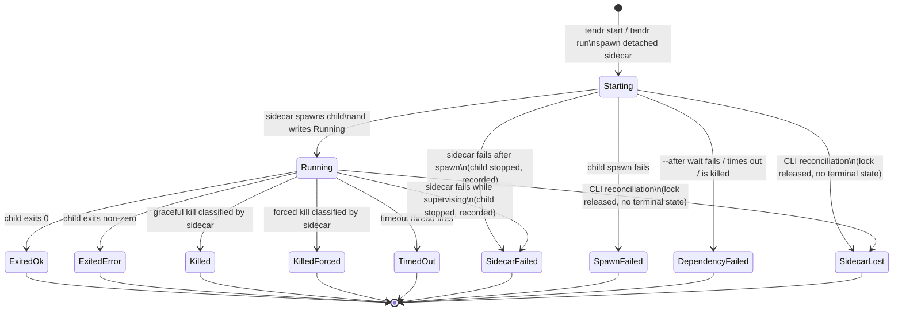

# Run Lifecycle

Tendr models supervised runs, not raw processes. The sidecar is the normal
writer of lifecycle state. The CLI writes lifecycle state only during
reconciliation, in two cases:

- It infers `SidecarLost`: the lock is released and no terminal state was
  written.
- It *heals* a terminal state (`Exited*`, `SpawnFailed` or
  `DependencyFailed`). The sidecar appended the terminal event, then died
  before it wrote `meta.json`. Reconciliation copies that event into meta.

**The invariant.** Once the child is spawned, one of three things is true:

1. The sidecar is alive and owns the child.
2. Meta is terminal and the child is dead.
3. The sidecar died by a true crash, and the next reconciliation reaches
   state 2.

No child is left running without a supervisor and without a record. A true
crash is anything that ends the sidecar without unwinding: SIGKILL, OOM,
`abort`, and any signal it does not handle. SIGTERM, SIGINT and SIGHUP are
among those. The one gap is listed under [Limits](#limits).



In `meta.json`, `status` is one of `Starting`, `Running`, `SpawnFailed`,
`Exited`, `SidecarLost` or `DependencyFailed`. An `Exited` status carries a
`reason`: `ExitedOk`, `ExitedError`, `Killed`, `KilledForced`, `TimedOut` or
`SidecarFailed` (`src/model/state.rs`). Transitions are checked at runtime in
`src/model/transition.rs`.

## Who writes each transition

This follows Theme 2, One Authority Per Fact, in
[../design-principles.md](../design-principles.md).

The sidecar writes:

- `Starting -> Running`
- `Starting -> SpawnFailed`
- `Starting -> DependencyFailed`
- `Running -> Exited*`: `ExitedOk`, `ExitedError`, `Killed`, `KilledForced`,
  `TimedOut`
- `Starting | Running -> SidecarFailed`: the sidecar's own record that it
  failed while supervising. It is an `Exited` reason, so meta keeps the
  child identity.

CLI reconciliation writes the rest. It runs in `status`, `wait` and
foreground `run`:

- `SidecarLost`, when the lock is released with no terminal state. If the
  lost sidecar's child is still alive, reconciliation kills it first (see
  [True crashes](#true-crashes-reconciliation-kills-the-orphan)).
- A healed terminal state, copied from the sidecar's own terminal event. The
  sidecar's observation and provenance are kept, not re-derived.

## Transition provenance

Every transition after `Starting` sets `transition_provenance` in
`meta.json` (`src/model/provenance.rs`). It describes the latest transition
only; the event log holds the full history.

```json
"transition_provenance": {"kind": "direct", "evidence": ["sidecar_write", "child_exit_observed"]}
```

`kind` is `direct` when the sidecar recorded what it observed. It is
`inferred` when reconciliation concluded the transition from indirect
evidence. A `Starting` meta has no `transition_provenance`.

| Transition | `kind` | `evidence` |
|---|---|---|
| `Running` | `direct` | `sidecar_write`, `child_spawned` |
| `SpawnFailed` | `direct` | `sidecar_write`, `spawn_failed_syscall` |
| `Exited` (child exit, kill, timeout) | `direct` | `sidecar_write`, `child_exit_observed` |
| `Exited` with `SidecarFailed` | `direct` | `sidecar_write`, `supervision_failed` |
| `DependencyFailed` | `direct` | `sidecar_write`, `dependency_failed` |
| `SidecarLost` | `inferred` | `lock_released`, `non_terminal_meta`, plus `orphan_killed` if it killed the child |
| healed terminal state | `direct` | `event_log_terminal`, plus `orphan_killed` for a healed `SidecarFailed` whose child it killed |

Lifecycle events carry the same `kind` as `data.provenance` (`"direct"` or
`"inferred"`); see [07-event-protocol.md](07-event-protocol.md).

## Dependency wait (`start --after`)

The dependency wait happens while the run is in `Starting`. Before it starts,
the sidecar writes `Starting` to `meta.json`. It then scans every dependency
once, before it signals readiness to `start` (`first_dependency_scan` in
`src/sidecar.rs`). So when `start` returns, either every dependency has been
inspected once, or a terminal state was written first.

The first scan has three outcomes:

| Outcome | What happens |
|---|---|
| Every dependency already satisfied | Signal readiness, then spawn at once. |
| Some pending, none failed | Signal readiness with `Starting`, then poll every 500 ms. |
| A dependency failed, the timeout passed, or a kill request arrived | Write `DependencyFailed` to meta, then signal readiness with that snapshot. |

A satisfied dependency is *latched* to the `run_id` it was observed at and is
never inspected again. One deadline, set before the first scan, covers the
whole wait.

Each dependency is bound to `(session, run_id)`. If a pending dependency is
replaced with `--replace`, the waiter fails. It never follows a different
run. By default a dependency is satisfied only by `ExitedOk`; `--any-exit`
accepts any terminal state.

## The lifecycle guard

In the sidecar, a `SupervisedRun` (`src/sidecar/supervised_run.rs`) owns the
child from the moment it is spawned. It also owns the kill handle, meta, the
event writer, the session lock, any readiness still owed to the `start`
client, and, for a PTY session, the attach socket.

A PTY session's attach socket is bound, and `a.sock.path` written, *before*
the child is spawned. So a PTY session never runs without its listener. A
bind failure there is `SpawnFailed`: no child exists yet, so the guard has
nothing to own. After spawn, the guard removes the socket and `a.sock.path`
on every exit, before it releases the session lock.

- `SupervisedRun<Spawned>::publish_running` is the only way to reach
  `SupervisedRun<Running>`. So everything `Running` promises exists before
  `Running` is published: the `--stdin` transport and, for a PTY session, its
  recorder, input writer and attach listener.
- `finish(reason)` is the only normal exit.
- Any other exit (an error, an early return, a panic unwinding) stops the
  child through the platform kill path. On Unix that is the child's process
  group; a PTY child leads its own session. On Windows it is the Job Object.
  The guard then records `Exited { reason: SidecarFailed { step } }`.
- The type parameter covers only the in-process guard. Persisted meta is
  still checked at runtime in `transition.rs`, because a type parameter does
  not survive serialization.

What a failed post-spawn step does:

| Step (`step`) | Action | Reason |
|---|---|---|
| readiness to the client (`readiness`), and the meta rewrite that records a lost delivery | recover, with a warning | Readiness only informs the client that asked; the run never depends on it. It is a `#[must_use]` value, not a `Result`. |
| `child_pid` breadcrumb (`breadcrumb`) | recover, with a warning | Only crash recovery reads it. |
| PTY I/O setup (`attach_bind`): the recorder, the input writer, and the listener on the socket bound before spawn | end the run | A PTY session never runs without its listener. The listener reaches the PTY only through the input writer. |
| `output.log` open (`output_log`) | recover: drain the output, warning `output not captured` | The exit is still worth recording, and a child that nobody reads blocks on a full pipe. |
| stdin transport (`stdin_transport`) | end the run | A `--stdin` run whose input can never arrive is a failed run. |
| publishing `Running` (`running_meta`) | end the run | `Running` must be observable. |
| observing the exit (`child_wait`) | end the run | An exit that cannot be observed cannot be classified. |
| terminal meta after a normal exit | not a kill: save a copy to lost+found, still run hooks | The durable terminal event lets reconciliation heal meta. |

A `SidecarFailed` run shows up in these places:

- meta: `"reason":"SidecarFailed","step":…` and a warning
  `sidecar failed at <step>: <error>`
- the event log: a durable `run.sidecar_failed` event
- exit code **5** from `wait`, `run` and `start`
- `--on-exit` hooks, run with `TENDR_EXIT_REASON=SidecarFailed`
- a `start` client still waiting, which receives the terminal snapshot

Exit code **3** (`SidecarLost`) means something else: the sidecar vanished,
so the child may still be running.

If the failure record itself cannot be written, the child is still stopped.
The failure is reported on the channels still open:

- a `start` client still waiting gets an `ERROR:` saying the record failed
- a copy of the record, with the write error, goes to
  `~/.tendr/lost+found/events.jsonl`
- the `child_pid` breadcrumb stays, so later recovery can find the child

## True crashes: reconciliation kills the orphan

The guard cannot run when the sidecar dies from an unhandled signal, OOM or
an abort. Reconciliation holds the session lock throughout and re-reads meta
under it. So a sidecar that wrote its terminal record just before releasing
the lock always wins.

When reconciliation infers `SidecarLost`, it looks for the child the sidecar
left behind:

- meta's `Running` child, or
- while meta is still `Starting` (the `--after` path), the `child_pid`
  breadcrumb.

It kills that child only if the process with that PID has the recorded start
time (`AliveVerified`). A reused PID is never killed. The kill is forced and
aimed at the process group, so `status` does not wait for a grace period.
The orphan-directory cleanup (below) uses the same identity rule.

The outcome is recorded:

- killed: `orphan_killed` evidence and a warning
- identity not verified, or the kill failed: a warning, and no kill
- child already gone: nothing

On Windows the child is in a kill-on-close Job Object that only the sidecar
holds. The kernel kills the process tree when the sidecar dies, so
reconciliation only records the loss.

If the sidecar's durable `run.sidecar_failed` event exists but its meta write
failed, reconciliation heals meta from that event. This also works on the
`--after` path, where meta was still `Starting`; the breadcrumb supplies the
child. The sidecar writes that event even when its forced kill did not take.
So the healed record's child gets the same identity-checked kill and the
same record: `orphan_killed` evidence beside `event_log_terminal` and a
warning when killed, a warning when it cannot be verified or killed, nothing
when it is already gone. No other healed record needs this check. An
observed exit means the sidecar reaped the child, and `SpawnFailed` or
`DependencyFailed` never had one.

## Limits

- **Crash before the breadcrumb.** The sidecar may crash after spawning the
  child but before it writes `child_pid`, or after that write failed
  (recovered with a warning). While meta is absent or `Starting`,
  reconciliation then has nothing to find. On Windows the Job Object still
  kills the child.
- **Processes outside the process group.** A process that leaves the child's
  process group is outside the group kill: one that calls `setsid` itself, or
  a job-control shell's jobs. For a PTY child the graceful stop therefore
  starts with SIGHUP to the group and waits up to one second for the leader
  to exit, as when a terminal window closes. An interactive shell ignores
  SIGTERM but passes the hangup on to its jobs as it exits.
  - The kernel's hangup, when the sidecar's end of the terminal closes, goes
    to the session leader, which by then is dead. A leader's own exit hangs
    up only the foreground group.
  - So a shell killed with SIGKILL (by `kill --force`, `--timeout` or the
    escalation) passes nothing on, and its jobs survive.
  - Processes the shell no longer tracks (`(cmd &)`, `disown`) survive any
    hangup, as they would a closed terminal window.
- **Graceful stop.** `kill` without `--force` sends SIGTERM to the group. It
  escalates to SIGKILL only while the child itself is alive. A descendant
  that ignores SIGTERM can outlive a leader that exits promptly. A PTY leader
  that exits on its hangup leaves SIGTERM for the group's remaining members,
  with no escalation. `--timeout` skips the graceful stop and sends SIGKILL to
  the group at once.
- **Crash before any meta.** The sidecar may crash, or fail to record its
  failure, before any meta was written. The orphan-directory cleanup in
  `status` and `start` handles this. It kills the breadcrumb's child by the
  same identity rule and removes the directory without a record. The only
  copy of the failure record is then the lost+found one.

Covered elsewhere:

- PTY control, which is separate from the run lifecycle:
  [04-pty-lane.md](04-pty-lane.md)
- the OS-specific mechanics of kill, wait and process identity: `src/platform/`
