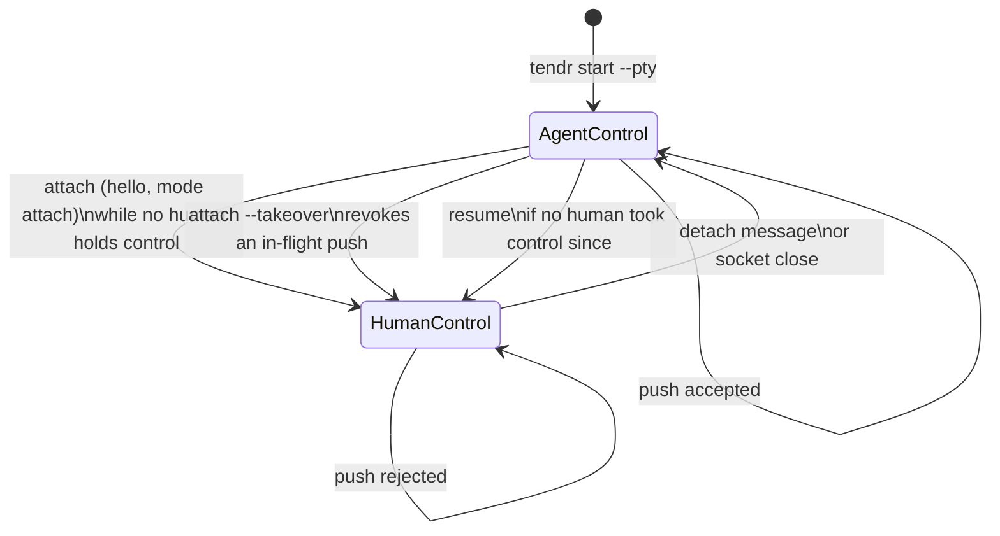
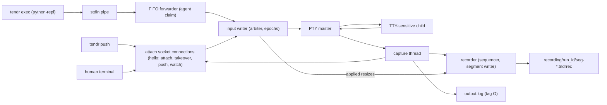
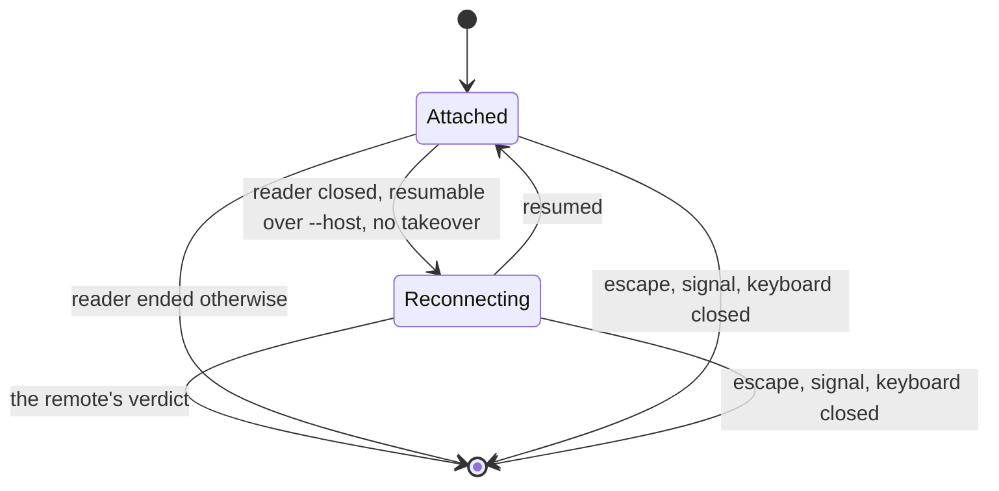

# PTY Lane

Tendr has two kinds of session:

- **Pipe session**: for machines. Supports `push` and `exec`. stdout and
  stderr stay separate.
- **PTY session**: for terminal programs. One merged transcript. Supports
  `push` and `attach`. Generic shell `exec` is refused; the Python REPL exec
  target is the exception (see [Exec on a PTY session](#exec-on-a-pty-session)).

This file describes how PTY sessions work: input ownership, the attach
protocol, the attach socket, the attach client, output delivery, and
recording.

## The PTY and the input writer

- `start --pty` spawns the child under a PTY. The sidecar owns the PTY
  master. Its read and write halves are nonblocking and poll-aware.
- One sidecar thread, the *input writer*, owns the run's `InputArbiter`
  (`src/model/pty_control.rs`) and the PTY input. It checks every write
  against the current controller epoch. It serves control requests before
  queued input.
- The input writer only decides ownership changes and revocations. It does
  not write to the session dir. Those side effects travel as typed effects
  on one channel to one *effects thread*, which writes them in order:
  - events: `pty.control_changed`, `pty.input_revoked`, `recording.stopped`.
    `pty.control_changed` carries `control`, `trigger` and `epoch`
    ([event protocol](07-event-protocol.md#1-envelope)).
  - `meta.json` patches: `pty.control`, `pty.recording`

  So a slow disk never delays a takeover's acknowledgement, an input step,
  or capture.
- When the run ends, a flush on that channel writes every effect already
  decided, before the terminal record. The effects thread then stops, and
  anything sent later is dropped. Nothing reaches the session dir after the
  run releases its lock.

## `push` to a PTY session

- A PTY `push` needs no `--stdin`. That flag only adds the FIFO that PTY
  `exec` uses.
- `push` connects to the attach socket in push mode (`Mode::Push`). It
  claims control as an agent. The claim is refused if anyone holds control,
  so two pushes never interleave.
- It streams input frames, which the input writer writes one at a time, and
  ends with `MSG_INPUT_DONE {written | revoked | closed, accepted,
  received}`.
- The CLI exits 84 with the byte counts unless every byte was written.
- `accepted` counts bytes written to the PTY master. It does not mean the
  child has read them. The CLI never resends input.
- Both ends handle frames as the typed `attach_proto::Frame`. The decoder
  rejects an outcome that breaks these rules, or has an unknown status:
  - `written` requires every received byte to be accepted.
  - `accepted` is never more than `received`.
- A frame of a message type this version does not know
  (`FrameError::Unknown`) is read whole and ignored, like a malformed one.
  So a later version can add types. `Frame` holds only frames this version
  can write back exactly.
- A push whose every frame was written is `written`, even if a takeover
  lands before its end marker is served. The CLI also succeeds when all of
  stdin was sent and accepted but a takeover cut the connection before the
  end marker was read.
- While a human is attached, `push` is refused.

## The attach handshake

- Every connection opens with a hello (`MSG_HELLO`, `[version, mode]`).
  The sidecar speaks versions 1 to 3 (`attach_proto::Version`); any other
  version is refused with the protocol class.
- Version 2 changes only what a viewer (an attach or takeover) receives. A
  push is answered the same in both versions.
  - Version 1 accepts with `MSG_ACCEPTED`, the controller epoch, and sends
    output as plain `MSG_DATA`.
  - Version 2 accepts with `MSG_ACCEPTED_V2`: `[epoch u64][run id 16
    bytes][head u64]`, all big-endian. The head is the offset of the first
    output byte the viewer gets, read under the lock capture appends under,
    so a viewer that has received no output yet still knows where it
    stands.
  - Version 2 sends the run's output as `MSG_OUTPUT`, `[offset u64][bytes]`:
    the offset of the first byte, counted from the run's start (below,
    [Output and viewers](#output-and-viewers)). Each frame starts where the
    last ended. The mode replay is not the run's output and still goes as
    plain `MSG_DATA`, unstamped.
  - A version 1 client never receives either new type.
- Version 3 adds only the end of a viewer's output. Its answers are version
  2's, and so is its output.
  - Once a viewer's sender has sent the run's last byte, it sends
    `MSG_OUTPUT_END`, `[final offset u64]`, and nothing more. A viewer cut
    off before then (evicted a ring behind, retired, or shut at the run's
    end while still behind) never gets it. That includes one whose
    connection took the last output but not the end itself before the
    session stopped waiting: it has every byte, but cannot know it, and is
    counted cut off.
  - It comes as the session flushes its viewers, before the run's end is
    recorded, so a client that exits on it may do so a moment before
    `meta.json` and the event log say the run ended.
  - The viewer's output must have reached that offset; an end at any other
    is a protocol failure (80).
  - Only a version 3 hello or resume asks for it, so no client from before
    it receives the type.
  - A sidecar from before version 3 refuses a version 3 hello with the
    protocol class. The client says it again one version lower, and goes
    on stepping down to version 1 (an attach, takeover or push), or to
    version 2 (a watch).
- A watch hello (`Mode::Watch`, mode byte 4, any version) asks for a
  read-only viewer, a *watcher*
  ([Read-only viewers](#read-only-viewers)). The sidecar admits it with
  `MSG_WATCHING`: `[run id 16 bytes][head u64]`, big-endian, with no
  epoch, since a watcher holds no control. Version 1 then sends it plain
  `MSG_DATA`, version 2 `MSG_OUTPUT`, as for a controller, and version 3
  also `MSG_OUTPUT_END`. One accept serves every version: only a client
  that sends a watch hello receives it, and every such client knows it. A
  sidecar from before watchers decodes `[3, 4]` and `[2, 4]` as
  unsupported hellos and refuses each with the protocol class; the client
  then exits 80 saying so, never trying version 1. A client refuses (80) a
  controller's accept to
  its watch hello, so it never attaches with control it did not ask for.
- Instead of a hello, a version 2 viewer whose connection was lost can send
  `MSG_RESUME` to regain its control and output
  ([Resuming a viewer](#resuming-a-viewer)).
- A plain attach is refused while a human holds control. A watch is not:
  it contends for nothing.
- `--takeover` replaces the holder, which is disconnected and exits 81. The
  holder is told in one of two ways:
  - `MSG_RETIRED`, when the sidecar can send it: up to 200 ms of lock
    attempts plus a 200 ms write timeout.
  - The event log, when it cannot. A client that has stopped reading its
    output holds up the sidecar's writes to it, and could not read a
    message queued behind that output anyway. The sidecar ends its
    connection only once the takeover's `pty.control_changed` is in the
    event log, or after 2 s if the state root is stalled. It waits the same
    way when an output write was in flight at its first attempt, even if
    `MSG_RETIRED` was then sent: that write may have stopped part-way
    through a frame, leaving the message unreadable. When the client reads
    again and reaches the end of its connection, it checks its run's
    events: a `takeover` granting the epoch after its own, and no `detach`
    releasing its own. A client that had already let go, for example one
    dropped for falling behind, is not taken over by a later `--takeover`
    and exits 0.
- A client frozen when it is taken over (its terminal or SSH connection
  stopped) stays alive, blocked writing to its terminal, until it is
  resumed. It has no control, and its connection is gone; it only learns
  of the takeover, and exits 81, once it runs again.
- The hello must complete within one overall deadline of 5 s
  (`attach_proto::HELLO_TIMEOUT`). Any frame that declares more than 64 KiB
  closes the connection.
- A sidecar admits attach connections from separate pools, each slot
  returned when its connection ends however it ends. A connection holds a
  **pending** slot (five, `PENDING_CONNECTIONS`) until its first frame (hello
  or resume) is read, then gives it back before taking the slot of the mode
  it asked for:
  - **watchers**: eight (`WATCH_CONNECTIONS`);
  - **controllers and pushes**: attaches, takeovers, resumes and pushes
    share eight (`CONTROLLER_CONNECTIONS`; a retiring controller keeps its
    connection for up to about 2.4 s, so repeated takeovers need the cap).

  So a full set of watchers never keeps a controller out, nor the reverse.
  A connection that finds its pool full is refused with a runtime refusal
  (84). A hello refused before any mode slot (a protocol refusal) used only
  its pending slot. Five connections that never send a hello refuse every
  new connection for up to 5 s; four leave room. The socket is owner-only
  and peer-checked, so only the owner can cause this.

### Read-only viewers

- A watcher is sent the run's output beside the controller, from the head
  at its admission, after the mode replay. It never holds or changes
  control: it never reaches the input writer, so it gets no epoch, records
  no `pty.control_changed`, and a human holding control does not keep it
  out.
- The sidecar reads a watcher's frames only for its end: its `MSG_DATA`,
  `MSG_RESIZE` and `MSG_REPAINT` are dropped, so its keystrokes never reach
  the child and its terminal never sizes the PTY.
- Watchers live in their own set beside the controller's viewer, keyed by
  an identity the input writer never grants control to. A takeover retires
  only the holder the arbiter names, so it never touches a watcher. Watchers
  are in the connection registry (`Retirement::Watcher`) only so the run's
  end shuts them down with every other connection.
- A watcher sends no size and no repaint. Attached to a full-screen
  program, it shows nothing new until the program next redraws, and then at
  the controller's size, not its own.
- `attach --read-only` is the watcher client: it drops keystrokes, says so
  on the terminal's last row at the first one, and still detaches with the
  escape. The note is part of the status line: it stays while attached,
  and leaving erases the last row it was drawn on. Session output may draw
  over it or scroll it up meanwhile; the client does not follow it, so then
  the row erased holds the session's latest line. With
  `--host` the attach bridge passes it through, and it reconnects as a
  watcher ([Attaching over `--host`](#attaching-over---host)).
- With no terminal (stdin or stdout is not one), `attach --read-only`
  streams instead: the client's no-terminal layer never reads stdin and
  waits only on the connection and the cancelling signals. stdout gets the
  mode replay and then the run's output bytes, and nothing else: no status
  line, and no mode resets when leaving unless stdout is a terminal. Every
  notice goes to stderr. A write to stdout that fails (a pipeline's consumer
  gone) sends `MSG_DETACH` and exits 1; a cancelling signal exits 1 as for
  any attach.
- How a watcher's attach ends, when the session closes its connection:
  - A local watcher speaks version 3 (see
    [the handshake](#the-attach-handshake)). `MSG_OUTPUT_END` at the offset
    its output reached means it has all of the run's output: exit 0.
    Without it the session cut it off, at the run's end too, when the
    session stopped waiting for it ([Output and viewers](#output-and-viewers)):
    exit 84, saying on stderr how many bytes of the run's output it had.
    This holds with a terminal as well.
  - A session started before version 3 sends no end. A watcher without a
    terminal then reads `meta.json` for up to 2 s, or up to 30 s once the
    attach socket is gone (the run is ending and recording it): the run
    ended (0), or the watcher was cut off, evicted a ring behind or shut by
    the sidecar (84). That reading cannot see a watcher cut off at the
    run's end: it exits 0, short. One with a terminal exits 0.
  - Over `--host` the remote tendr, which knows the version its sidecar
    speaks, decides the same way for every watcher, terminal or not, and
    the client exits with its verdict
    ([transport boundaries](06-transport-boundaries.md#the-attach-bridge)).
- Accepted on an exe.dev VM over `--host` on 2026-11-03: eight watchers
  and a controller with a ninth refused, four stalled hellos, takeovers
  with watchers attached or stalled, a watcher's resume after a real drop,
  and the no-terminal exits
  ([results](../../scripts/pty-vm/README.md#read-only-viewers-over-attach---host)).

### Resuming a viewer

A version 2 viewer whose connection was lost opens a new one with
`MSG_RESUME` in place of the hello: `[epoch u64][run id 16 bytes][offset
u64]`, the run, the epoch it held and the offset just past the last output
byte it wrote to its terminal. One connection decides both control and
bytes ([design](../design.md#a-resume-decides-control-and-output-on-one-connection)).

- A resume naming another run is refused with the control class (81).
- The control rule is `InputArbiter::resume` (`src/model/pty_control.rs`).
  It grants the epoch after the current one, never the epoch it held, and
  only if both hold:
  - no human has been granted control since that epoch, by an attach, a
    takeover or another resume, even one already released;
  - nobody else holds control now. An agent push that ran and finished in
    between does not block it; one still running does.

  Otherwise it is refused with the control class (81).
- After a lost link, the old connection is often still open (sshd keeps the
  old bridge alive) and still holds its epoch. The resume retires it as a
  takeover retires a holder: `MSG_RETIRED` if it can be sent, otherwise just
  the end of its connection, and the event log then shows a resume, not a
  takeover of it. Its late disconnect releases nothing, because its epoch is
  no longer current.
- The change is recorded as `pty.control_changed` with trigger `resume`, never
  `takeover`. So a client cut off without `MSG_RETIRED` never reads a resume
  as a takeover, and a later takeover of the resumed client, which grants the
  epoch after the resumed one, is still read as one (81).
- Then the bytes, under the lock capture appends under:
  - **Resumed** (`MSG_RESUMED`, the new epoch and the offset asked for) if the
    output ring still holds that offset. The output from there follows,
    stamped, with no mode replay: the terminal already has those modes.
  - **Gone** (`MSG_GONE`, `[epoch][run id][head][oldest]`) otherwise. It
    names exactly what the ring holds, `oldest` up to `head`. The mode replay
    follows, unstamped, then the output from the head, stamped. A client
    first turns off the modes it tracked, since the replay only turns modes
    on, and after the replay sends its size and a repaint, as a fresh attach
    does. An offset past the head is answered gone as well; the client
    treats that as a protocol failure (80), since its own count is broken.
- A sidecar that predates resuming refuses `MSG_RESUME` with the protocol
  class, as it refuses anything that is not a hello.
- From version 3 a resume names its version: one byte after its point
  (without it the resume is version 2). A sidecar from before version 3
  refuses that with the protocol class, and the bridge says the resume
  again in version 2.
- A watcher resumes with its own frame, `MSG_WATCH_RESUME`: `[run id 16
  bytes][offset u64]`, the encoding of `MSG_WATCHING`, with no epoch
  ([design](../design.md#a-watch-resume-carries-no-epoch)). It takes a
  watcher's slot and never reaches the input writer: a resume for another
  run is refused (81), and otherwise the sidecar answers it as above, at
  epoch 0, which names no control: `MSG_RESUMED` with the output from the
  offset asked for, or `MSG_GONE` with the mode replay and the output from
  the head. The watcher reads only the run and the offsets, and after a
  gone answer sends no size and no repaint. A sidecar from before watch
  resumes refuses the frame with the protocol class (80 on the client).

### Refusals

A refusal, `MSG_REJECTED`, has the payload `[class u8][reason UTF-8]`. The
client acts on the class (`attach_proto::RejectClass`). The reason is only
for people.

| Class | Name | Meaning | Client exit code |
|---:|---|---|---:|
| 1 | protocol | no hello, or an unsupported version or mode | 80 |
| 2 | control | someone holds the terminal, the run has ended, or a resume the control rule refuses | 81 |
| 3 | runtime | the input writer stopped, or every connection slot is in use | 84 |
| 4 | identity | the peer is another user | 85 |

- An empty payload, or a class this version does not know, is a malformed
  frame. A client never guesses at a refusal.
- The set of classes is part of the protocol version. The hello carries the
  client's version, and a sidecar sends only the classes that version knows.
  A new class requires a new version; versions 1 to 3 know the same four.
- A refusal sent before the hello is read (another user's peer, no free
  slot) may use only classes every supported version knows.

The `attach` and PTY `push` clients use the same exit-code range for their
own failures ([guide](../guide.md#exit-codes), `tendr::pty_exit`):

| Failure | Exit code |
|---|---:|
| no reply to the hello within 10 s, or a reply outside the protocol | 80 |
| the CLI's own human-control or not-running check; an attach retired by another client's `--takeover` | 81 |
| socket missing or unreachable | 84 |
| listener belongs to another user | 85 |

A `push` to a pipe session that is not running exits 1.

## Input arbitration

- Input queued by a controller that is superseded (a takeover) or leaves (a
  detach or a lost connection), and not yet written to the PTY master, is
  never written. It is recorded as `pty.input_revoked`, after the
  `pty.control_changed` that ended its control. Bytes already written stay in
  the PTY's buffer for the child.
- PTY `exec` frames arrive over the stdin FIFO. The FIFO forwarder is
  arbitrated the same way, but it cannot report an outcome:
  - It waits behind another agent's push.
  - A human holder refuses it. The frame is discarded and recorded as a run
    warning.
- A frame keeps the agent claim until the child has read all of it, even
  after its writer has closed the FIFO. `exec` closes the FIFO as soon as the
  frame is in the pipe, so a closed writer is how every frame ends.
- A child that never reads again holds the input until a human runs
  `attach --takeover`.

## The attach socket

- The socket is bound in `~/.tendr/sockets` (owner-only directory, `0600`
  socket, short name derived from the session and run;
  [02-session-storage.md](02-session-storage.md#pty-attach-socket)).
- Its parent, `~/.tendr`, is checked first. Anyone who can write it could
  rename `sockets/` away and break the owner's attach and next start. It must
  be a directory (symlinks followed) owned by the user. The sidecar removes
  group and other write permission from it, leaves the other bits alone, and
  records the change as a run warning. A root owned by another user fails the
  start. The root is the parent of the sessions directory, found by position,
  not by name.
- The socket is bound, and `a.sock.path` written, before the child is
  spawned. An unsafe directory, an overlong path, or an existing path fails
  the start as `SpawnFailed`, with `attach_socket_failed` evidence. The
  session never runs without a listener.
- After spawn, the lifecycle guard owns the socket. If the recorder, input
  writer or listener cannot start, the guard stops the child and records
  `SidecarFailed { step: attach_bind }`
  ([03-run-lifecycle.md](03-run-lifecycle.md#the-lifecycle-guard)).
- Both ends verify the peer's user id.
- A sidecar killed outright cannot remove its socket. `prune` removes such
  orphans and reports them as `sockets_removed`. It removes a socket only if
  all three hold:
  - no session's `a.sock.path` names it
  - nothing listens on it
  - it is over a minute old

  So `prune` never touches a socket a live session could use. A crashed
  session's socket becomes removable once the session is pruned or
  replaced, and the next `prune` removes it.

## The `attach` client

- The client keeps keyboard input, session writes and terminal output on
  separate paths:
  - The main thread polls the keyboard and terminal size and only queues
    messages. Resize, repaint and detach go ahead of keystrokes.
  - A sender thread writes the queued messages.
  - A reader thread writes output to the terminal.
- The client core (`src/commands/attach/client.rs`) touches no descriptor,
  signal or console API. Raw mode, the keyboard, the size, writes to the
  screen and the signals belong to the terminal layer
  (`src/commands/attach/terminal.rs`). It takes the terminal's state before
  anything that may change it starts, ssh included, restores it on every way
  out, and discards typed-ahead input. On Unix the keyboard is read from the
  descriptor it polls, never through `std::io::Stdin`, whose buffer would
  hold bytes the poll cannot see. Debug builds accept
  `TENDR_TEST_ATTACH_TERMINAL=<rows>x<cols>`: a test terminal on piped stdio,
  which the scripted-remote tests (`tests/cli_attach_scripted.rs`) drive.
  With `TENDR_TEST_ATTACH_SCREEN_HOLD=<path>` too, it takes no writes while
  that file exists, as a terminal that has stopped reading.
- `Ctrl-\ d` detaches. `Ctrl-\` twice sends one `Ctrl-\`. `--escape none`
  disables the escape. Why this escape:
  [design](../design.md#detach-is-a-fixed-two-key-escape).
- The escape is recognised in the legacy byte encoding, and in the kitty
  keyboard protocol and xterm `modifyOtherKeys` encodings that a child can
  switch the terminal to (`src/attach_escape.rs`). Forwarded bytes are always
  the bytes typed.
- Key releases, repeats of `\`, and modifier-key events neither complete nor
  cancel a held prefix. A `\` repeat never starts one.
- Outside a paste, an unfinished `ESC [` at the end of a read is held only
  while it could still become a prefix or a paste start. The main thread's
  poll wakes after 20 ms to forward it, so a lone Esc is never stuck.
- While the child has bracketed paste on (the client tracks it with the
  other terminal modes), every byte inside a paste (`ESC [ 200 ~` …
  `ESC [ 201 ~`) is forwarded as text, so pasted `Ctrl-\` bytes neither start
  the escape nor detach. A read that ends inside a possible paste end holds
  it until the next byte, with no deadline. Turning bracketed paste off ends
  a paste. A fuzz target checks a paste is forwarded whole however reads cut
  it: `cargo +nightly fuzz run escape_paste` (the `fuzz/` crate, not in CI).
- The terminal size is checked every 100 ms and changes are forwarded.
  SIGWINCH (on Windows, `WINDOW_BUFFER_SIZE_EVENT`) only brings that check
  forward, because such notices coalesce.
- SIGHUP, SIGTERM and SIGINT end the attach like a detach: a detach message
  with the same bounded grace, then the terminal is restored. The client
  exits 1 with `tendr: attach ended by SIG…`. A signal inherited as ignored
  stays ignored.
- The signal handlers only set a flag and write a byte to a self-pipe in the
  main thread's `poll()`. The previous dispositions are restored when the
  relay ends.
- `Ctrl-C` is a keystroke to the session, because raw mode clears `ISIG`.
- Leaving never waits on a blocked path. The terminal is restored without
  draining output, and a signal's report gives up on a terminal that is not
  reading. A connection whose input is backed up is still released promptly
  when its client hangs up.
- The session's end of a connection, by contrast, is drained: the client
  acts on it only once the reader is done, so the session's last output is
  on the terminal before the attach ends with its code, reconnects or
  reports a takeover, however slowly the terminal takes it. A write the
  sender could not make (the far end has closed) only means that end is on
  its way. The keyboard stays live meanwhile, so the escape and the signals
  still leave at once.

### The relay's phases, and where the bytes are

The client is in one phase at a time (`client::Phase`), and how it ends
(`client::Ending`) decides the exit code:

A connection's reader thread returns why it stopped (`client::ReaderEnd`).
The relay reads that only once the thread is done, so every byte the
reader will write is on the terminal first. Then `client::after_reader`
decides:

|Reader end|Next|
|---|---|
|the terminal, or stdout, refused a write|end, detaching|
|output outside the protocol|end, 80|
|`MSG_OUTPUT_END` at the offset reached|end, the run's output complete|
|stream closed, a resume point and no takeover|reconnect over `--host`; locally, end: 0, or 84 for a watcher promised an end|
|stream closed otherwise|end: the remote's code (0 locally), 81 after a takeover|

A leave that arrived as the session's side ended wins over that end. A
takeover is noted as the reader sees `MSG_RETIRED`, apart from its end,
because a leave before the connection closes still reports it.

Keystrokes pass through these places on their way to the child. Each one
says what happens to bytes it holds when something ends:

|Hop|Holds|On a leave, takeover or lost link|
|---|---|---|
|the client's tty input queue|what the kernel has not handed over; on Unix read in 4 KiB from the descriptor polled|discarded when the terminal is restored|
|the escape parser (`attach_escape.rs`)|a held prefix, an unfinished sequence (up to 64 bytes, forwarded after 20 ms), or a possible paste end (held until the next byte)|discarded|
|the client's outbox|up to 1 MiB of keystrokes behind the controls; more are dropped and counted (`N typed bytes were dropped`)|on a leave the detach goes ahead of them; then the connection closes, and what is still queued is never sent. While reconnecting there is no outbox, and keystrokes are discarded with a notice|
|ssh, then the bridge's outbox (`--host` only)|the bridge stops reading ssh's stdin at 1 MiB, so the backlog waits in ssh|as the client's|
|the sidecar's input queue (`pty_input.rs`)|32 writes; the connection's reader waits for room unless its client hung up|cancelled and recorded ([input arbitration](#input-arbitration))|
|the PTY master|what the child has not read|kept for the child; once the PTY is closed (a write takes 0 bytes), that write and every later one end `Incomplete(Closed)`, unreported to an attach, since the run is ending|

Output passes through these:

|Hop|Holds|On an end|
|---|---|---|
|the output ring|the run's latest 32 MiB, by offset|a viewer more than a ring behind is disconnected; a controller loses control, and a watcher promised an end exits 84|
|the viewer's sender|one frame of up to 4 KiB|at the run's end it sends the rest and `MSG_OUTPUT_END` (version 3), within 2 s|
|the bridge (`--host` only)|one whole frame, flushed as it is written|a frame the sidecar cut off is not passed on|
|the client's reader|one frame, checked against the offset reached|written in full before the relay acts on the end; on a leave, it writes nothing more|
|the terminal|what it has not yet drawn|restored without waiting for it|

### Attaching over `--host`

`attach --host` runs this same client on the laptop, Unix or Windows: raw
mode, the size check, the escape, mode tracking and
restoring the terminal. Only its connection differs. Instead of the attach
socket it speaks the same frames over ssh's stdin and stdout, to a remote
tendr that bridges them to the session's socket
([transport boundaries](06-transport-boundaries.md#the-attach-bridge)).

- The handshake is the one above, and the request agrees its version
  ([transport boundaries](06-transport-boundaries.md#the-attach-bridge)):
  the remote tendr speaks the newest version both the client and the
  sidecar know, applies the 10 s reply deadline and classifies the reply,
  so refusals keep their exit codes. On success it passes the sidecar's
  acceptance to the client as it came.
- On a version 2 attach, the client keeps the run, the offset just past the
  last output byte written to the terminal and, for a controller, the epoch;
  a read-only attach is always version 2 or later over `--host`, and keeps
  the run and offset. It moves the offset under the lock it writes the
  terminal under, once the write has succeeded, so the offset never counts
  bytes the terminal did not take. Stamped output that does not start at
  that offset, any stamped output on a version 1 attach, or an end of
  output (`MSG_OUTPUT_END`) at any other offset, is a protocol failure: the
  client restores the terminal and exits 80. The local `attach` speaks
  version 1 for a controller, which does not reconnect, so has no use for
  offsets, and version 3 for a watcher, which checks the end of output
  against them.
- The end of output, passed on by the bridge, ends the attach as the
  session closing it does, never as a lost link: the client does not
  reconnect, and exits with the remote's verdict
  ([transport boundaries](06-transport-boundaries.md#the-attach-bridge)).
- The sidecar keeps the controller epochs and the recording. The bridge only
  passes frames on; it decides nothing about control.
- A client that stops reading backs up its output through ssh and the
  bridge to the sidecar, which then treats it as above: it falls behind in
  the output ring, and a takeover retires it through the event log. The
  bridge's input and output directions are separate, so the stalled client's
  resize and detach still reach the sidecar, and its controls go ahead of
  its input on a bounded path.
- When the sidecar ends the connection of a client taken over without
  `MSG_RETIRED`, the bridge checks the event log as the local client does
  and sends `MSG_RETIRED` itself, so the client exits 81 when it reads again.
- A version 2 client whose connection ends from the far side, without
  `MSG_RETIRED` and without output outside the protocol, hands ssh's end to
  a reconnect thread (`commands::attach::client::reconnect`;
  [design](../design.md#a-dropped-attach---host-reconnects-by-itself-judged-by-sshs-exit))
  once the old connection's reader is done, so the offset is final and
  every byte it got is on the terminal, whatever follows:
  - It waits up to 5 s for ssh's exit. The remote's exit code ends the
    attach with that code. ssh's 255 without an exit trailer, ssh killed
    (by a signal; on Windows, an exit below), or ssh still running then is
    a lost link. A leave the client has received but not yet read (a
    signal, a console control event) wins over an end it raced: the same
    signal or event can end ssh, which shares the terminal.
  - A lost link is resumed from that point over a new ssh with
    `BatchMode=yes` (`commands::attach::resume_host`): the request carries
    the point, and a `MSG_RESUME` takes the hello's place on ssh's stdin,
    which the bridge passes on in the version it speaks to the sidecar
    ([Resuming a viewer](#resuming-a-viewer)). A watcher's request stays
    read-only, and its frame is `MSG_WATCH_RESUME`.
  - A transport failure (255 without a trailer, ssh killed, the connect
    deadline) is tried again after 1 s, doubling to at most 30 s, with no
    limit on the number of attempts. Any remote verdict ends it: a refusal
    exits with its code (81 for the control rule or an ended run, 80 for a
    session that cannot resume).
  - Meanwhile the main thread keeps the keyboard: it discards keystrokes,
    noting it once in the status line, and leaves on the escape, SIGHUP,
    SIGTERM, SIGINT or a console control event, which stop the reconnect's
    ssh (a flag polled every 20 ms by its wait, then SIGTERM and SIGKILL, or
    on Windows `TerminateProcess`) for up to 2 s.
  - The status goes on the terminal's last rows, written under the lock the
    output is written under, with the cursor saved and restored (DECSC,
    DECRC): tendr's line, and ssh's latest stderr line on the row below
    (such as the `Timeout, server not responding.` the lost
    connection's ssh said as it gave up), as printable ASCII cut to the
    width. It is erased before the new connection's output is written.
    A watcher's read-only note gives its row to the status, and is drawn
    again once the watcher has resumed; a reconnect that ends the attach
    erases both. While a connection is up its ssh stderr is kept off the
    screen too.
    What ssh said on the last attempt, or since the last connection came
    up, is printed once the terminal is restored, since it holds the
    remote's reason for a refusal.
  - On `MSG_RESUMED` the new connection relays from the same offset. On
    `MSG_GONE` the client first writes the reset of the modes it tracked
    and a notice of how many bytes it missed and how many the session no
    longer held, then relays the replay and the output from the head; the
    notice is printed again once the terminal is restored, since a program
    on the alternate screen covers it. Either way a controller then sends
    its size and the repaint nudge, the size first so the nudge can apply;
    a watcher sends neither.
  - Without a terminal (a read-only attach streaming to stdout, Unix only),
    stdout still gets only the session's output: the status lines and the
    gone notice go to stderr, a line each, and so does ssh's stderr, as it
    comes; no mode reset is written to stdout.
- A Windows client drives its console through the Windows terminal layer
  (`src/commands/attach/terminal/windows.rs`), and ssh through
  `tendr::platform::spawn_external`, as every other ssh tendr starts:
  - The console's input and output modes and output code page are taken
    before ssh starts, since ssh shares the console, and put back on every
    way out: a refusal, the connect deadline, a panic, a leave.
  - Input mode: the console's own plus virtual terminal input, window and
    mouse events, without line input, echo, processed input or QuickEdit.
    Keys and mouse reports therefore arrive as the bytes a Unix terminal
    sends, and `Ctrl-C` as 0x03 for the session. Output mode adds virtual
    terminal processing and `DISABLE_NEWLINE_AUTO_RETURN`. A console that
    cannot take them (before Windows 10 1809, or "Use legacy console") is
    refused before ssh starts, and so is a stdin that is a terminal but not
    a console (mintty).
  - The keyboard is read with `ReadConsoleInputW`, waiting on the console
    and an event the control handler sets. Key presses give their UTF-16
    character `wRepeatCount` times, joined into UTF-8 across events and
    reads; releases give nothing, except Alt's after an Alt-numpad entry.
    A batch of records with no typing is not the end of input. A press
    with neither a character nor a key is Ctrl-Space, sent as NUL.
  - Output is written with `WriteFile` under the UTF-8 output code page,
    so session output that is not UTF-8 is shown, not refused as Rust's
    console `Stdout` would. The size is the visible window (`srWindow`).
  - `CTRL_BREAK_EVENT` (the keyboard's Ctrl-Break, or another program's),
    `CTRL_C_EVENT` raised by another program in the console, and
    `CTRL_CLOSE_EVENT` end the attach as the Unix signals do
    (`tendr: attach ended by CTRL_BREAK_EVENT`). The close event's handler
    waits, under Windows's 5 s limit, until the console has been put back.
  - Restoring discards typed-ahead input (`FlushConsoleInputBuffer`).
  - Drop classification is shared, with Windows's ways for ssh.exe to be
    killed in place of a signal (`ssh::classify`): an NTSTATUS exit (the
    two severity bits not both clear, such as `0xC000013A` after Ctrl-C or
    Ctrl-Break, or a crash) and, once a connection has been up, exit 1
    without an exit trailer (`TerminateProcess`, as Task Manager uses it,
    gives 1), at the connection's end or on a reconnect's dial, are lost
    links, and the attach reconnects. The Unix remote an attach runs on
    never ends with 1 and no trailer
    ([the exit trailer](06-transport-boundaries.md#the-exit-trailer)); the
    first dial still keeps a 1, which a PowerShell login shell gives for a
    tendr too old to write a trailer. A Unix client keeps 1 as the remote's
    code. So a reconnect's dial that exits 1 with no trailer is a failed
    attempt on Windows, tried again after the backoff, and on Unix ends the
    attach with 1, as the first dial would; both are tested by the scripted
    remote (`tests/cli_attach_scripted.rs`), each on its own platform. The
    status line, its backoff, a resume, a gone answer and the
    escape mid-reconnect are tested under a pseudo console
    (`tests/windows_attach_console.rs`).

## Output and viewers

- PTY output is merged and recorded as `O` lines in `output.log`.
- For each chunk of output, capture first hands it to the recorder, then
  writes it to `output.log`, then appends it to the run's output ring.
  The recorder does not wait for its storage, so a viewer can receive bytes
  before they are on disk. After a failed `output.log` write, capture skips
  the log for the rest of the run; the recorder and the viewer still get
  every chunk.
- Capture ends when the terminal does, or soon after the child exits. A
  background job that keeps the terminal is captured for at most 2 s after
  the child has exited and its output has been read (the holder grace, timed
  from when the sidecar closes its descriptor, below). Capture then ends, the
  child is reaped and its exit recorded, and on Linux a run warning names
  the pids that still hold the terminal (found through `/proc/*/fd`). A
  stop ends every process the run started that it can find before the end
  is recorded, holders included, so after a stop the terminal closes and
  capture ends without the grace (run lifecycle,
  [Stopping a run](03-run-lifecycle.md#stopping-a-run)). On macOS the
  session leader's exit revokes the terminal from every process, so capture
  ends with the child there.
- The sidecar keeps its own descriptor for the PTY's slave side
  (close-on-exec, never its controlling terminal) until the child has exited
  and capture has read the master until it would block; then it closes it.
  A thread observes the exit with `waitid(WNOWAIT)` and wakes the reader
  through a pipe, so `child_wait` still reaps the child and the reader never
  polls on a timer. Without the descriptor, the child's exit would be the
  last close of the slave. macOS then waits only about 0.65 s for the master
  to read what is pending before discarding it, so a reader starved of CPU
  lost a short-lived child's output (`platform::unix::PtyReader`).
- So on macOS a PTY child's exit waits in the kernel, with no time limit,
  until capture has drained the master. A shell that opened `/dev/tty`
  already waited this way. Every stop (`kill`, `--timeout`, a sidecar
  failure) therefore first restarts output stopped by `^S` (`TCOON`). A
  graceful stop (`kill` or `--timeout`) while capture is reading keeps the
  descriptor, so what the child writes as it stops is captured. A forced
  stop (`kill --force`), or any stop while no reader is running (a sidecar
  failure before capture, or a stop that lands before capture has taken the
  reader), closes it at once,
  so no exit waits on a reader that cannot drain; that child's last unread
  output is then subject to the 0.65 s discard again. A reader that ends
  early (an error, a panic) also closes it. A child that exits while its
  output is stopped by `^S` stays exiting until `^Q` or a stop.
- Every output byte has an offset: the count of output bytes before it in
  the run. Capture appends each chunk to one output ring per run, under the
  attach sink's lock, so offsets are assigned in one place. The ring keeps
  the last 32 MiB, from the first viewer on. A viewer is a cursor into it,
  the offset of the next byte it gets; its own sender thread sends from
  there. A sender blocked writing to a client that stopped reading cannot
  see its cursor evicted, so after each append capture checks every cursor
  (at most nine: the controller's and eight watchers') and shuts down the
  connection of each one the ring evicted (it fell 32 MiB behind); a
  controller cut off this way loses control. Capture never waits for a
  viewer, so a viewer never stalls capture, the child, or other viewers.
- At the run's end, once capture has appended its last output, the sidecar
  finishes the ring and waits up to 2 s for every viewer's sender, the
  controller's and the watchers', to have sent everything up to the final
  offset (`sidecar::flush_viewers`), and a version 3 viewer's to have sent
  `MSG_OUTPUT_END` after it; only then does it shut the connections down.
  Without it a viewer behind at the end lost the run's last bytes. A viewer
  that is not reading is cut off at the 2 s, short of them and with no end
  of output, so a version 3 watcher knows it was cut off (84) rather than
  taking the run's end for having had everything.
- A version 2 viewer gets each byte's offset ([the attach
  handshake](#the-attach-handshake)); why offsets and not recording sequence
  numbers: [design](../design.md#viewers-count-output-in-bytes-and-agree-the-version-in-the-request).
  A viewer that lost its connection can resume from its offset ([Resuming a
  viewer](#resuming-a-viewer)), which `attach --host` does by itself
  ([Attaching over `--host`](#attaching-over---host)).
- Capture also tracks the terminal modes the child's output turns on
  (`term_modes::TermModes`, which lists them): among them the alternate
  screen, mouse tracking, bracketed paste, kitty keyboard flags (one stack
  per screen) and `modifyOtherKeys`. When a viewer is installed, the
  sequences that turn those modes on are sent first, ahead of its cursor.
  The replay and the cursor are both taken under the lock capture holds
  while it appends, so no output lands between them. A full reset (`ESC c`)
  from the child clears the tracked modes.
- The client tracks the same modes over everything it writes to the terminal,
  and however the attach ends it writes their inverse once: each kitty
  keyboard stack popped as many times as it was pushed, the alternate screen
  left, the other modes turned off. Once leaving starts the reader writes
  nothing more, so at most the chunk being written precedes the inverse. The
  client waits at most 1 s for a terminal that is slow or not reading, 200 ms
  after a signal. Without this, a detached terminal kept the child's mouse
  reports and keyboard protocol, so mouse moves typed escape sequences into
  the shell and `Ctrl-C` arrived as `ESC[99;5u`.
- The child starts at 24×80. It gets `TERM=xterm-256color` when the launching
  environment's `TERM` was missing, empty, `dumb`, or removed with
  `--unset-env TERM`. An explicit `--env TERM` wins (`sidecar::pty_term`).

## Recording

Each PTY run is recorded exactly, under `<session>/recording/<run_id>/`
(`0700` directories, `0600` segments). The byte format is in
[08-pty-recording-format.md](08-pty-recording-format.md).

- Capture offers every output chunk to the recorder.
- The input writer applies each resize while holding the recorder's
  sequencer. So output that follows a new size is always recorded after it.
- A resize frame with a zero dimension does not parse and is ignored.
- Repaint nudge: after its first resize the client sends `MSG_REPAINT` once.
  If that resize left the PTY's size unchanged (a new size already makes the
  child redraw) and the client still holds control, the input writer shrinks
  the PTY by one row. The attach handler then waits until the child's output
  has been quiet for 50 ms, at most 500 ms, and asks the writer to restore
  the size. The restore applies unless a resize has applied since; it does
  not depend on control, so a client that leaves meanwhile does not leave the
  PTY a row short. Both records carry `REPAINT` and one correlation. Claude
  Code draws nothing on a same-size attach, on a same-size `TIOCSWINSZ`, or
  on SIGWINCH at an unchanged size, but redraws fully on each of the pair
  ([measured](../../scripts/pty-vm/README.md#claude-code-in-a-tendr-pty) on
  an exe.dev VM). A sidecar that predates the frame ignores it.
- Input is not recorded.
- Sequencing never waits for storage. One recorder thread appends, rotates
  segments at 64 MiB, publishes each segment atomically, and syncs at most
  one second apart and on close.
- Recording stops at the last completed append when any of these happens:
  - the run's recording reaches 1 GiB
  - storage fails
  - 16 MiB of output is waiting for storage
  - storage is still stalled at close

  An append that completes after the stop is cut off again.
- The recorder only queues the stop on the run's effects channel, at the
  moment it stops. The effects thread writes it as `recording.stopped` and
  in `meta.json` (`pty.recording.state: Stopped`, with the last recorded
  sequence), before the run's terminal record, never after it.
- After a stop the run ends with a warning. The child and viewers keep
  running.
- A lost sidecar cannot record its stop. When reconciliation infers
  `SidecarLost`, it marks a recording still `Recording` as `Stopped` with
  reason `sidecar_lost` and no last sequence, and logs `recording.stopped`
  from `tendr.cli` before `run.sidecar_lost`. The segments on disk hold what
  was recorded.
- When reconciliation instead heals the run from the sidecar's terminal
  event (the sidecar died before writing `meta.json`), the recorder had
  already finished: its end, or any stop, comes before the terminal event.
  Only the recording's final meta write was lost, so reconciliation marks a
  recording still `Recording` as `Stopped` with reason `end_unrecorded` and
  no last sequence. It logs no event, since a `recording.stopped` would
  follow the run's terminal event. The segments on disk hold the complete
  recording.

`cargo run --example dump-recording -- <path>` prints a recording as text.
`<path>` is a segment file, a run's recording directory, or a session
directory. It prints one line per record with output bytes escaped, and flags
terminal queries and mode changes, including ones split across records. It is
a development tool over the library's `recording::dump`, not part of the
`tendr` binary. Its layout is not a stable interface.

## Exec on a PTY session

- Generic shell `exec` is refused on PTY sessions.
- `ExecTarget::PythonRepl` is allowed. It reads its result from a side-channel
  file instead of the transcript (see [05-key-flows.md](05-key-flows.md#exec)).
