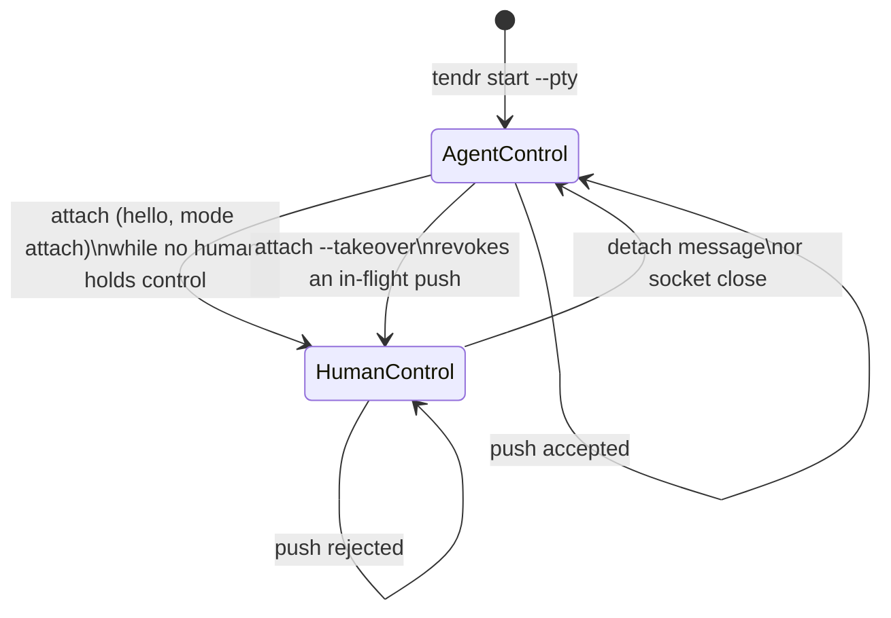
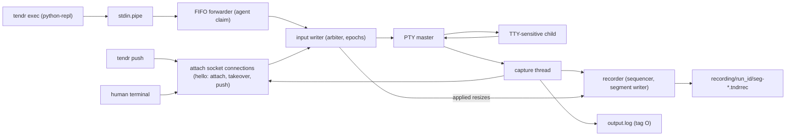

# PTY Lane

Tendr has two kinds of session:

- **Pipe session**: for machines. Supports `push` and `exec`. stdout and
  stderr stay separate.
- **PTY session**: for terminal programs. One merged transcript. Supports
  `push` and `attach`. Generic shell `exec` is refused; the Python REPL exec
  target is the exception (see [Exec on a PTY session](#exec-on-a-pty-session)).

This file describes how PTY sessions work: input ownership, the attach
protocol, the attach socket, the attach client, output delivery, and
recording.

## The PTY and the input writer

- `start --pty` spawns the child under a PTY. The sidecar owns the PTY
  master. Its read and write halves are nonblocking and poll-aware.
- One sidecar thread, the *input writer*, owns the run's `InputArbiter`
  (`src/model/pty_control.rs`) and the PTY input. It checks every write
  against the current controller epoch. It serves control requests before
  queued input.
- The input writer only decides ownership changes and revocations. It does
  not write to the session dir. Those side effects travel as typed effects
  on one channel to one *effects thread*, which writes them in order:
  - events: `pty.control_changed`, `pty.input_revoked`, `recording.stopped`
  - `meta.json` patches: `pty.control`, `pty.recording`

  So a slow disk never delays a takeover's acknowledgement, an input step,
  or capture.
- When the run ends, a flush on that channel writes every effect already
  decided, before the terminal record. The effects thread then stops, and
  anything sent later is dropped. Nothing reaches the session dir after the
  run releases its lock.

## `push` to a PTY session

- A PTY `push` needs no `--stdin`. That flag only adds the FIFO that PTY
  `exec` uses.
- `push` connects to the attach socket in push mode (`Mode::Push`). It
  claims control as an agent. The claim is refused if anyone holds control,
  so two pushes never interleave.
- It streams input frames, which the input writer writes one at a time, and
  ends with `MSG_INPUT_DONE {written | revoked | closed, accepted,
  received}`.
- The CLI exits 84 with the byte counts unless every byte was written.
- `accepted` counts bytes written to the PTY master. It does not mean the
  child has read them. The CLI never resends input.
- Both ends handle frames as the typed `attach_proto::Frame`. The decoder
  rejects an outcome that breaks these rules, or has an unknown status:
  - `written` requires every received byte to be accepted.
  - `accepted` is never more than `received`.
- A frame of a message type this version does not know
  (`FrameError::Unknown`) is read whole and ignored, like a malformed one.
  So a later version can add types. `Frame` holds only frames this version
  can write back exactly.
- A push whose every frame was written is `written`, even if a takeover
  lands before its end marker is served. The CLI also succeeds when all of
  stdin was sent and accepted but a takeover cut the connection before the
  end marker was read.
- While a human is attached, `push` is refused.

## The attach handshake

- `attach` must open with a version 1 hello (`MSG_HELLO`).
- A plain attach is refused while a human holds control.
- `--takeover` replaces the holder, which is disconnected. The sidecar first
  sends it `MSG_RETIRED`, best-effort: a client that has stopped reading its
  output misses it and sees only end of stream.
- The hello must complete within one overall deadline of 5 s
  (`attach_proto::HELLO_TIMEOUT`). Any frame that declares more than 64 KiB
  closes the connection.
- A sidecar admits at most eight attach connections at once
  (`MAX_ATTACH_CONNECTIONS`), counting those still waiting for their hello.
  Eight connections that never send a hello can refuse a takeover for up to
  5 s. The socket is owner-only and peer-checked, so only the owner can cause
  this.

### Refusals

A refusal, `MSG_REJECTED`, has the payload `[class u8][reason UTF-8]`. The
client acts on the class (`attach_proto::RejectClass`). The reason is only
for people.

| Class | Name | Meaning | Client exit code |
|---:|---|---|---:|
| 1 | protocol | no hello, or an unsupported version or mode | 80 |
| 2 | control | someone holds the terminal, or the run has ended | 81 |
| 3 | runtime | the input writer stopped, or every connection slot is in use | 84 |
| 4 | identity | the peer is another user | 85 |

- An empty payload, or a class this version does not know, is a malformed
  frame. A client never guesses at a refusal.
- The set of classes is part of the protocol version. The hello carries the
  client's version, and a sidecar sends only the classes that version knows.
  A new class requires a new `PROTOCOL_VERSION`.
- A refusal sent before the hello is read (another user's peer, no free
  slot) may use only classes every supported version knows.

The `attach` and PTY `push` clients use the same exit-code range for their
own failures ([guide](../guide.md#exit-codes), `tendr::pty_exit`):

| Failure | Exit code |
|---|---:|
| no reply to the hello within 10 s, or a reply outside the protocol | 80 |
| the CLI's own human-control or not-running check; an attach retired by another client's `--takeover` | 81 |
| socket missing or unreachable | 84 |
| listener belongs to another user | 85 |

A `push` to a pipe session that is not running exits 1.

## Input arbitration

- Input queued by a superseded controller is never written. It is recorded
  as `pty.input_revoked`.
- PTY `exec` frames arrive over the stdin FIFO. The FIFO forwarder is
  arbitrated the same way, but it cannot report an outcome:
  - It waits behind another agent's push.
  - A human holder refuses it. The frame is discarded and recorded as a run
    warning.
- A frame keeps the agent claim until the child has read all of it, even
  after its writer has closed the FIFO. `exec` closes the FIFO as soon as the
  frame is in the pipe, so a closed writer is how every frame ends.
- A child that never reads again holds the input until a human runs
  `attach --takeover`.

## The attach socket

- The socket is bound in `~/.tendr/sockets` (owner-only directory, `0600`
  socket, short name derived from the session and run;
  [02-session-storage.md](02-session-storage.md#pty-attach-socket)).
- The socket is bound, and `a.sock.path` written, before the child is
  spawned. An unsafe directory, an overlong path, or an existing path fails
  the start as `SpawnFailed`. The session never runs without a listener.
- After spawn, the lifecycle guard owns the socket. If the recorder, input
  writer or listener cannot start, the guard stops the child and records
  `SidecarFailed { step: attach_bind }`
  ([03-run-lifecycle.md](03-run-lifecycle.md#the-lifecycle-guard)).
- Both ends verify the peer's user id.
- A sidecar killed outright cannot remove its socket. `prune` removes such
  orphans and reports them as `sockets_removed`. It removes a socket only if
  all three hold:
  - no session's `a.sock.path` names it
  - nothing listens on it
  - it is over a minute old

  So `prune` never touches a socket a live session could use. A crashed
  session's socket becomes removable once the session is pruned or
  replaced, and the next `prune` removes it.

## The `attach` client

- The client keeps keyboard input, session writes and terminal output on
  separate paths:
  - The main thread polls the keyboard and terminal size and only queues
    messages. Resize and detach go ahead of keystrokes.
  - A sender thread writes the queued messages.
  - A reader thread writes output to the terminal.
- `Ctrl-\ d` detaches. `Ctrl-\` twice sends one `Ctrl-\`. `--escape none`
  disables the escape. Why this escape:
  [design](../design.md#detach-is-a-fixed-two-key-escape).
- The escape is recognised in the legacy byte encoding, and in the kitty
  keyboard protocol and xterm `modifyOtherKeys` encodings that a child can
  switch the terminal to (`src/attach_escape.rs`). Forwarded bytes are always
  the bytes typed.
- Key releases, repeats of `\`, and modifier-key events neither complete nor
  cancel a held prefix. A `\` repeat never starts one.
- An unfinished `ESC [` at the end of a read is held only while it could
  still become a prefix. The main thread's poll wakes after 20 ms to forward
  it, so a lone Esc is never stuck.
- The terminal size is checked every 100 ms and changes are forwarded.
  SIGWINCH only brings that check forward, because signals coalesce.
- SIGHUP, SIGTERM and SIGINT end the attach like a detach: a detach message
  with the same bounded grace, then the terminal is restored. The client
  exits 1 with `tendr: attach ended by SIG…`. A signal inherited as ignored
  stays ignored.
- The signal handlers only set a flag and write a byte to a self-pipe in the
  main thread's `poll()`. The previous dispositions are restored when the
  relay ends.
- `Ctrl-C` is a keystroke to the session, because raw mode clears `ISIG`.
- Leaving never waits on a blocked path. The terminal is restored without
  draining output, and a signal's report gives up on a terminal that is not
  reading. A connection whose input is backed up is still released promptly
  when its client hangs up.

## Output and viewers

- PTY output is merged and recorded as `O` lines in `output.log`.
- For each chunk of output, capture first hands it to the recorder, then
  writes it to `output.log`, then offers it to the attached viewer's queue.
  The recorder does not wait for its storage, so a viewer can receive bytes
  before they are on disk. After a failed `output.log` write, capture skips
  the log for the rest of the run; the recorder and the viewer still get
  every chunk.
- Capture ends when the terminal does, not when the child exits: a
  background job that keeps the terminal keeps capture going until it closes
  it. On macOS the session leader's exit ends the session's use of the
  terminal, so capture ends with the child there.
- The sidecar keeps its own descriptor for the PTY's slave side
  (close-on-exec, never its controlling terminal) until the child has exited
  and capture has read the master until it would block; then it closes it.
  A thread observes the exit with `waitid(WNOWAIT)` and wakes the reader
  through a pipe, so `child_wait` still reaps the child and the reader never
  polls on a timer. Without the descriptor, the child's exit would be the
  last close of the slave. macOS then waits only about 0.65 s for the master
  to read what is pending before discarding it, so a reader starved of CPU
  lost a short-lived child's output (`platform::unix::PtyReader`).
- So on macOS a PTY child's exit waits in the kernel, with no time limit,
  until capture has drained the master. A shell that opened `/dev/tty`
  already waited this way. Every stop (`kill`, `--timeout`, a sidecar
  failure) therefore first restarts output stopped by `^S` (`TCOON`). A
  graceful `kill` while capture is reading keeps the descriptor, so what the
  child writes as it stops is captured. A forced stop (`kill --force` or
  `--timeout`), or any stop while no reader is running (a sidecar failure
  before capture, or a `kill` that lands before capture has taken the
  reader), closes it at once,
  so no exit waits on a reader that cannot drain; that child's last unread
  output is then subject to the 0.65 s discard again. A reader that ends
  early (an error, a panic) also closes it. A child that exits while its
  output is stopped by `^S` stays exiting until `^Q` or a stop.
- The viewer's queue holds at most 8 MiB. The viewer's own sender thread
  drains it. A viewer that stops reading is disconnected and loses control. It
  never stalls capture or the child.
- A viewer gets no recording sequence numbers, so a viewer that disconnects
  cannot resume from where it stopped. The typed attach bridge in
  [remote frame transport](../plans/active/01_remote-frame-transport.md)
  step 5 adds this.
- Capture also tracks the terminal modes the child's output turns on
  (`term_modes::TermModes`, which lists them): among them the alternate
  screen, mouse tracking, bracketed paste, kitty keyboard flags (one stack
  per screen) and `modifyOtherKeys`. When a viewer is installed, the
  sequences that turn those modes on are queued first, under the lock capture
  holds while it offers output, so no output lands between them. A full reset
  (`ESC c`) from the child clears the tracked modes.
- The client tracks the same modes over everything it writes to the terminal,
  and however the attach ends it writes their inverse once: each kitty
  keyboard stack popped as many times as it was pushed, the alternate screen
  left, the other modes turned off. Once leaving starts the reader writes
  nothing more, so at most the chunk being written precedes the inverse. The
  client waits at most 1 s for a terminal that is slow or not reading, 200 ms
  after a signal. Without this, a detached terminal kept the child's mouse
  reports and keyboard protocol, so mouse moves typed escape sequences into
  the shell and `Ctrl-C` arrived as `ESC[99;5u`.
- The child starts at 24×80. It gets `TERM=xterm-256color` when the launching
  environment's `TERM` was missing, empty, `dumb`, or removed with
  `--unset-env TERM`. An explicit `--env TERM` wins (`sidecar::pty_term`).

## Recording

Each PTY run is recorded exactly, under `<session>/recording/<run_id>/`
(`0700` directories, `0600` segments). The byte format is in
[08-pty-recording-format.md](08-pty-recording-format.md).

- Capture offers every output chunk to the recorder.
- The input writer applies each resize while holding the recorder's
  sequencer. So output that follows a new size is always recorded after it.
- A resize frame with a zero dimension does not parse and is ignored.
- Input is not recorded.
- Sequencing never waits for storage. One recorder thread appends, rotates
  segments at 64 MiB, publishes each segment atomically, and syncs at most
  one second apart and on close.
- Recording stops at the last completed append when any of these happens:
  - the run's recording reaches 1 GiB
  - storage fails
  - 16 MiB of output is waiting for storage
  - storage is still stalled at close

  An append that completes after the stop is cut off again.
- The recorder only queues the stop on the run's effects channel, at the
  moment it stops. The effects thread writes it as `recording.stopped` and
  in `meta.json` (`pty.recording.state: Stopped`, with the last recorded
  sequence), before the run's terminal record, never after it.
- After a stop the run ends with a warning. The child and viewers keep
  running.

`cargo run --example dump-recording -- <path>` prints a recording as text.
`<path>` is a segment file, a run's recording directory, or a session
directory. It prints one line per record with output bytes escaped, and flags
terminal queries and mode changes, including ones split across records. It is
a development tool over the library's `recording::dump`, not part of the
`tendr` binary. Its layout is not a stable interface.

## Exec on a PTY session

- Generic shell `exec` is refused on PTY sessions.
- `ExecTarget::PythonRepl` is allowed. It reads its result from a side-channel
  file instead of the transcript (see [05-key-flows.md](05-key-flows.md#exec)).
