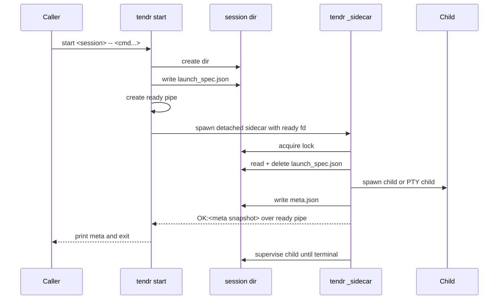
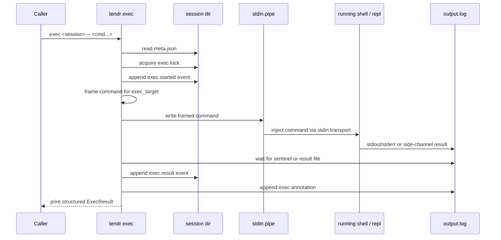
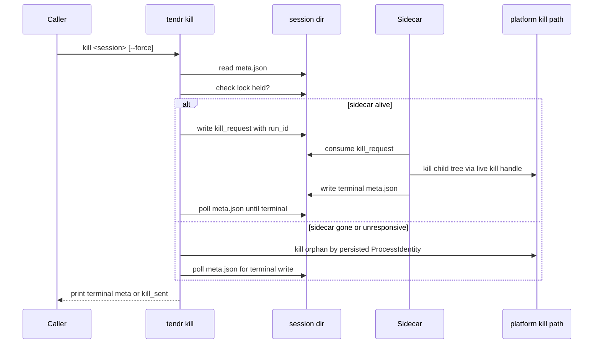
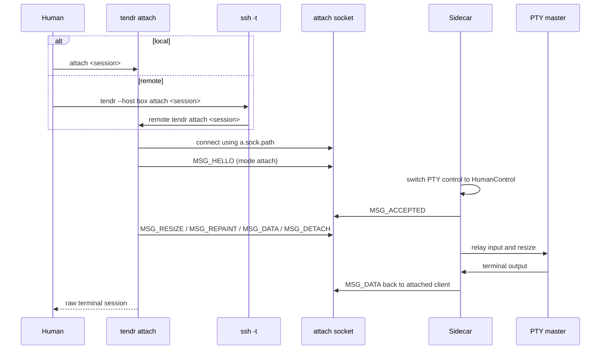

# Key Flows

These are the main command sequences. Each shows where the CLI exits, where
the sidecar takes over, and which boundaries use files, pipes or sockets.

## `start`

Notes:

- With `--after`, the sidecar writes `Starting`, scans every dependency once,
  and only then signals readiness. See
  [03-run-lifecycle.md](03-run-lifecycle.md#dependency-wait-start---after).
- If spawn fails, the sidecar sends a `SpawnFailed` snapshot over the ready
  pipe and the CLI exits non-zero.
- The sidecar inherits only stdio (on `/dev/null`) and the ready fd. Before
  exec, `spawn_sidecar` marks every other fd above 2 close-on-exec: one
  `close_range(CLOSE_RANGE_CLOEXEC)` on Linux 5.11 and later, else the fds
  listed in `/dev/fd` before the fork. So a descriptor the caller leaked
  reaches neither the sidecar nor the child, whose spawn inherits only the
  sidecar's own fds, all opened close-on-exec.
- Readiness only informs the CLI; the run never depends on it. If the CLI
  is gone before the sidecar signals (killed, or its terminal closed), the
  write fails. The sidecar records a `readiness not delivered` warning in
  meta and carries on.
- If the sidecar itself fails after spawn and before readiness, it stops the
  child, records `SidecarFailed`, and sends that snapshot. The CLI exits 5
  (see [03-run-lifecycle.md](03-run-lifecycle.md#the-lifecycle-guard)).

## `exec`

`exec` requires a running session started with `--stdin` and an exec target.
On a PTY session only the `python-repl` target is allowed; DuckDB needs a
pipe session.

### How `exec` finds the result

The exec target decides how the command is framed and how the result comes
back (`src/exec_frame.rs`, `src/commands/exec.rs`):

| Exec target | Result channel | Completion signal |
|---|---|---|
| POSIX shell | `output.log` | stderr end marker `__TENDR_EXEC_ERR__ <token>`, then stdout sentinel `__TENDR_EXEC__ <token> <exit> <cwd>` |
| DuckDB | `output.log` | stdout sentinel, then up to 100 ms for trailing stderr |
| Python REPL | `exec-results/<token>.json` | the result file appears |
| PowerShell | `exec-results/<token>.json` | the result file appears |

- **Sentinel framing (POSIX shell, DuckDB).** The frame prints a sentinel
  line with the token after the command. `exec` scans `output.log` from the
  offset it recorded before sending.
  - The sidecar logs stdout and stderr from separate threads. So for a POSIX
    shell, `exec` waits for both markers. If the stderr marker never comes
    (for example, the shell's stderr was redirected), it gives up waiting
    one second after the sentinel.
  - Either marker may end a line rather than start one, when the command's
    last output has no newline. The bytes before the marker are command
    output.
  - The POSIX frame exports `TENDR_BLOCK_ID` for the command only, then
    unsets it.
  - DuckDB's sentinel always reports exit code 0, because SQL has no exit
    status. `exec` sets the exit code to 1 if any stderr was captured.
- **Side-channel result file (Python REPL, PowerShell).** The frame
  base64-encodes the code and the result path. It runs the code, captures
  stdout, stderr, exit code and working directory, and writes them as JSON
  to `exec-results/<token>.json` (temporary file, then rename). `exec` polls
  for the file, reads it, and deletes it. A Python traceback is appended to
  stderr.

### Timeouts

A timed-out exec prints its result and exits 124. It keeps holding
`exec.lock` until the shell or REPL finishes the frame (the sentinel or
result file appears) or the session ends. So a second exec cannot
interleave into a busy session.

### Events and annotation

`exec` appends `exec.started` and `exec.result` events with a fresh
`block_id` ([07-event-protocol.md](07-event-protocol.md)). It then appends
one `A` line (`source: agent.exec`) to `output.log`. That line carries
`event_id` and `block_id`, so it links to the `exec.result` event.

An annotation line is at most 4096 bytes. `write_exec_annotation` tries
each form in turn and writes the first that fits:

1. The full record: command, stdout, stderr, exit code, `cwd_after`.
2. The same record with stdout and stderr each cut to 3000 bytes, marked
   `truncated: true`.
3. A breadcrumb (`event: exec_truncated`) with the command, the stdout and
   stderr lengths and SHA-256 digests, exit code, and `cwd_after` cut to 512
   bytes.
4. The same breadcrumb without the command. Every remaining field has a
   fixed or bounded size, so this form always fits.

Falling back is silent: there is no stderr warning. The JSON result printed
by `exec`, and its exit code, are never affected.

## `kill`

Notes:

- Kill requests carry the `run_id`. The sidecar ignores a request left over
  from a previous run.
- `kill --force` writes `kill_forced` before it signals. The sidecar writes
  `kill_acted` when it acts on a graceful request. The sidecar classifies the
  exit as `TimedOut`, `KilledForced` or `Killed` from its timeout state and
  these two files.
- The CLI waits up to 9 s for a live sidecar: up to 1 s for a PTY child's
  hangup, 5 s of graceful stop, and 3 s to write terminal state. If the
  sidecar does not act in time, the CLI kills the child itself and waits up
  to 5 s more.
- A run still in `Starting` (waiting on `--after`) has no child. `kill` sends
  the sidecar a request, and the dependency wait ends as
  `DependencyFailed`.

## `attach` (local and remote)

Notes:

- Remote attach still talks to the sidecar on the far host. SSH only carries
  the terminal.
- `attach` uses `ssh -t`. Other remote commands use `ssh -T`.
- Handshake, refusals and exit codes: [04-pty-lane.md](04-pty-lane.md).

## `run`

`run` wraps `start` for scripts:

- It parses `#tendr:` directives from the script.
- It resolves the interpreter or shell.
- It calls the same `launch_session` path as `start`.
- In foreground mode it follows `output.log` until the run is terminal, then
  exits with the code from the final `meta.json`.

## `wrap`

`wrap` runs a command inside a supervised process and records it:

- It needs `TENDR_RUN_ID`, so it must run inside a tendr-supervised process.
- It spawns the wrapped command directly and captures its stdin, stdout and
  stderr.
- With a valid `--event` kind, it appends an event and an `A` line linked by
  `event_id`. With a name that is not a valid kind, it appends only the `A`
  line. See [07-event-protocol.md](07-event-protocol.md#6-write-surface).
- If `wrap` itself is asked to stop (SIGTERM on Unix, a console control event
  on Windows), it stops the wrapped command the same way `kill` stops a child:
  gracefully first, then forcibly. It still records the result.
- It exits with the wrapped command's exit code.
