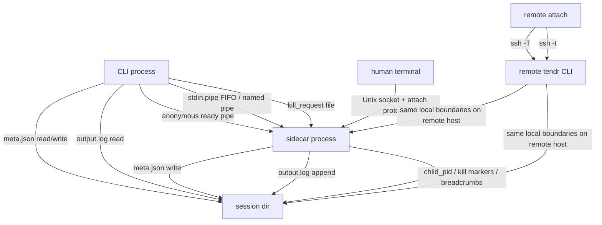

# Transport Boundaries

This file lists every place where bytes cross a process boundary. Everything
else is in-process logic.

## Boundary inventory

| Boundary | Who uses it | What it carries |
|---|---|---|
| Ready pipe | Created by `start`; used once at sidecar startup. | `OK:<meta>` or `ERROR:<message>`. |
| `stdin.pipe` | Created with `--stdin`. Used by `push` to a pipe session, and by `exec` to send framed commands. A PTY `push` uses the attach socket. | Raw input bytes. |
| `kill_request` | Written by `kill`; read by the sidecar's kill watcher. | `force` and `run_id`; a request for another run is ignored. |
| `output.log` | Appended by the sidecar, `wrap` and `exec`. Read by `log`, `watch`, `exec` and `events --include-logs`. | JSONL lines tagged `O`, `E` or `A`. |
| `events/*.jsonl` | Appended by the sidecar, `emit`, `exec`, `wrap` and reconciliation. Read by `events`, `watch` and `query`. | Event envelopes ([07-event-protocol.md](07-event-protocol.md)). |
| PTY attach socket | Unix socket under `~/.tendr/sockets`, found through `a.sock.path`. | The attach protocol: `MSG_HELLO`, `MSG_DATA`, `MSG_RESIZE`, `MSG_DETACH` and others ([04-pty-lane.md](04-pty-lane.md)). |
| SSH | `--host` on an allowlisted command. | The same CLI call, run on the remote host. |

## SSH transport

`--host` runs the same tendr command on the remote host. It adds no event
model or session store of its own.

| Over `--host` | Commands |
|---|---|
| supported | `start`, `status`, `list`, `log`, `push`, `kill`, `wait`, `watch`, `attach`, `exec` |
| local-only, exit 2 with a ready-to-paste `ssh <host> 'tendr …'` command | `run`, `wrap`, `prune`, `query`, `guide`, `skill` |
| local-only, exit 1 with the list of supported commands | `emit`, `events` |

`wrap` also needs the supervised-process environment, so it only works
inside a tendr-supervised process on the target host.

`attach` uses `ssh -t`; every other command uses `ssh -T`.

### Remote `exec`

`exec` sends the whole request as one JSON frame over ssh stdin to a remote
`tendr exec --frame-from-stdin`. Everything else runs on the remote host
exactly as for a local exec: the FIFO, `exec.lock`, the `output.log` scan, and
`exec-results/<token>.json`. Only the request frame and the JSON result cross
the SSH boundary.

### Connect deadline

The connect deadline (`src/ssh.rs`) catches an SSH connection that stalls
before the remote tendr starts.

- Every call except `attach` runs the remote as `tendr --hello …`. Its first
  stderr line is `ssh::HELLO_LINE` (`tendr-hello 1`).
- The local end reads stderr, drops the hello line, and passes the rest
  through.
- If the hello has not arrived within `TENDR_SSH_CONNECT_TIMEOUT` seconds
  (default 30), tendr sends ssh SIGTERM, then SIGKILL one second later. The
  call exits 82.
- After the hello there is no deadline, so `wait` and `log -f` run as long
  as they need.
- ssh's own `ConnectTimeout` ends at key exchange. Authentication can still
  stall afterwards; for example, a lapsed Tailscale SSH check-mode approval
  waits about 30 minutes with no output.
- The marker comes from the remote tendr, not from ssh's log. ssh's log is
  unreliable across ControlMaster reuse and OpenSSH versions.
- `attach` gets no deadline, because its stderr shares the terminal.
- `TENDR_SSH_CONNECT_TIMEOUT=0` sends no `--hello` and leaves stderr
  inherited. Use it to reach a remote tendr that does not know `--hello`.
- stdout stays inherited while a thread relays stderr. So the order between
  the two streams is not exact; each stream keeps its own order.

## In-process logic

These never cross a boundary:

- `Meta` transition methods
- launch-spec hashing and idempotency checks
- `watch` event formatting, once state and log lines are read
- annotation payload construction before append

## Execution environments

Tendr's IPC assumes one shared filesystem and one user ID, in one trust
domain. When sessions run in containers, VMs or other hosts, the question is
where the session dir lives.

| Axis | Tendr's position |
|------|-------------------|
| **Identity** | `ProcessIdentity { pid, start_time_ns }`. No container or VM ID. |
| **Lifecycle** | The `RunStatus` state machine. Container states such as `paused` or `restarting` are out of scope. |
| **Authority** | The kernel (process tables, signals), not a container daemon. |
| **Boundaries** | Implicit: whatever process tree the sidecar can see. |
| **IPC** | Shared filesystem and local sockets. Works inside any boundary that provides both. |

In practice:

- **Tendr inside a container** works best for persistent shells and REPLs.
  Tendr owns the child directly, and all IPC works normally.
- **Tendr outside, supervising `docker run ...`** works for foreground
  container jobs. Tendr supervises the `docker` client process, not the
  container. Do not use it with `docker run -d`: tendr would supervise the
  short-lived client and lose the real workload.
- **Sharing one session between containers** breaks Theme 2, One Authority
  Per Fact ([../design-principles.md](../design-principles.md)). A shared
  volume for artifacts is fine. Several tendr instances writing the same
  session state is not.

Tendr does not manage containers, VMs or orchestrators. The `--boundary`
field on `start` records where a session runs; it does not manage that
environment. Lifecycle events copy it into `run.starting` and `run.started`
only. See the [guide](../guide.md#record-where-a-session-runs---boundary).
