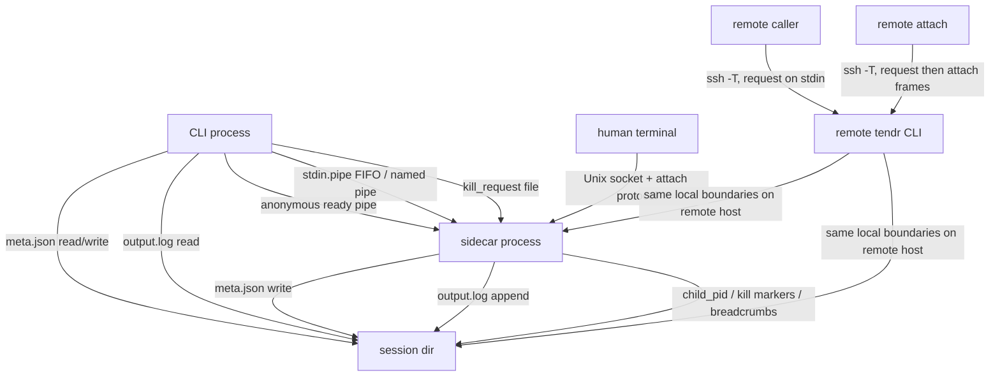

# Transport Boundaries

This file lists every place where bytes cross a process boundary. Everything
else is in-process logic.



## Boundary inventory

| Boundary | Who uses it | What it carries |
|---|---|---|
| Ready pipe | Created by `start`; used once at sidecar startup. | `OK:<meta>` or `ERROR:<message>`. |
| `stdin.pipe` | Created with `--stdin`. Used by `push` to a pipe session, and by `exec` to send framed commands. A PTY `push` uses the attach socket. | Raw input bytes. |
| `kill_request` | Written by `kill`; read by the sidecar's kill watcher. | `force` and `run_id`; a request for another run is ignored. |
| `output.log` | Appended by the sidecar, `wrap` and `exec`. Read by `log`, `watch`, `exec` and `events --include-logs`. | JSONL lines tagged `O`, `E` or `A`. |
| `events/*.jsonl` | Appended by the sidecar, `emit`, `exec`, `wrap` and reconciliation. Read by `events`, `watch` and `query`. | Event envelopes ([07-event-protocol.md](07-event-protocol.md)). |
| PTY attach socket | Unix socket under `~/.tendr/sockets`, found through `a.sock.path`. | The attach protocol: `MSG_HELLO`, `MSG_DATA`, `MSG_RESIZE`, `MSG_DETACH` and others ([04-pty-lane.md](04-pty-lane.md)). |
| SSH | `--host` on a remote-capable command. | One request as data on ssh stdin, run by the remote tendr; for `attach`, attach protocol frames follow it both ways. |

## SSH transport

`--host` runs the same tendr command on the remote host. It adds no event
model or session store of its own.

| Over `--host` | Commands |
|---|---|
| supported | `start`, `status`, `list`, `log`, `push`, `kill`, `wait`, `watch`, `attach`, `exec` |
| local-only, exit 2 with a ready-to-paste `ssh <host> 'tendr …'` command, quoted for a POSIX shell and labelled so | `run`, `wrap`, `prune`, `query`, `guide`, `skill` |
| local-only, exit 1 with the list of supported commands | `emit`, `events` |

`wrap` also needs the supervised-process environment, so it only works
inside a tendr-supervised process on the target host.

The remote command line is constant, so no value the user typed reaches the
remote login shell, whether that is bash, `cmd.exe` or PowerShell:

| Operations | Remote command line | Request |
|---|---|---|
| `start`, `status`, `list`, `log`, `push`, `kill`, `wait`, `watch`, `attach` | `ssh -T … tendr [--hello] --exit-trailer _remote` | The remote frame on ssh stdin |
| `exec` | `ssh -T … tendr [--hello] --exit-trailer exec --frame-from-stdin` | The exec frame on ssh stdin |

### The remote frame

`src/remote_frame.rs` carries one `RemoteOperation` (`src/remote_op.rs`) to
the hidden `tendr _remote` entry point. On ssh stdin:

```text
4-byte big-endian length N | N bytes of UTF-8 JSON | push only: the body, to EOF
                                                   | attach only: attach protocol frames
```

The JSON is the request under a version:

```json
{"v": 1, "op": "status", "params": {"session": "build", "namespace": null}}
```

- `op` is `start`, `status`, `list`, `log`, `push`, `kill`, `wait`, `watch`
  or `attach`; `params` holds what the user typed, unresolved. Namespace
  defaults and `--after` run IDs resolve on the remote host.
- The client refuses, with exit 2 and before ssh starts, a `--cwd` that is not
  UTF-8 (JSON carries UTF-8 only) and a header over 1 MiB.
- The client closes ssh stdin after the header, except for `push`, which then
  copies local stdin as it arrives, to its end, and `attach`, whose frames
  follow. The remote reads what follows through the same buffered stdin as
  the header, so no byte is lost.
- `_remote` reads exactly 4 + N bytes, refuses N over 1 MiB before reading
  the JSON, and checks the version, the operation and the values (names,
  `KEY=VALUE` entries, a non-empty command, flags that need another) before
  anything runs. A refused request prints `tendr _remote: <why>` and exits 2.
  Unknown JSON fields are ignored; an unknown `v` or `op` is refused.
- Otherwise the request runs as the same command typed on the remote host:
  stdout, stderr and exit code are the local command's, and `log -f` and
  `watch` stream. `attach` is the exception: the client keeps the terminal,
  and the remote tendr bridges the attach protocol
  ([The attach bridge](#the-attach-bridge)).
- A remote tendr from before the frame fails with clap's
  `unrecognized subcommand '_remote'` (or `unexpected argument
  '--exit-trailer' found`, or, older still, the same for `--hello`). The
  client passes that on and adds that the remote tendr is too old for this
  client and to upgrade it to 0.5.0 or newer, the first release with both
  the frame and the attach bridge. Old clients still work against a new
  remote tendr.

### The exit trailer

Under a PowerShell login shell (Windows PowerShell 5.1 and PowerShell 7),
ssh's exit status collapses to 0 or 1; `cmd.exe` and POSIX shells pass the
code on. Stdin and stderr pass through all three exactly, so the code also
travels on stderr:

- `tendr --exit-trailer <command>` (`src/main.rs`) runs the same command line
  without the flag as a child with the same stdin, stdout and stderr, then
  writes `tendr-exit <code>` as the last stderr line and exits with the
  code. The wrapper covers every exit path, panics included, and never reads
  stdin; the child writes the hello. The flag is accepted only before the
  subcommand. A child killed by a signal gets no trailer, and the wrapper
  exits 128 + the signal.
- The client's stderr relay (`src/ssh.rs`) holds back only a line that may be
  the trailer, and only while it is the last thing that arrived. A
  `tendr-exit <int>` line followed by anything else is the command's own
  output and is passed on. At end of stream a held trailer is dropped and its
  code becomes the call's exit code.
- Without a trailer the client falls back to ssh's status. ssh's 255 without
  a trailer is a connection failure; a trailer of 255 is the remote's code.
- So the Unix remote an attach runs on never ends with 1 and no trailer:
  the wrapper writes one for every code it gets, a command line it cannot
  parse exits 2, and a shell that cannot find tendr exits 127. On a Windows
  client an attach whose connection has been up therefore reads ssh.exe's
  1 without a trailer, at the connection's end or on a reconnect's dial, as
  ssh.exe killed (`TerminateProcess`, as Task Manager uses it, gives 1).
  A Windows client also reads an NTSTATUS exit (such as `0xC000013A` after
  Ctrl-C or Ctrl-Break), for any call, as ssh.exe ended by Windows, as a
  signal ends it on Unix (`ssh::classify`). Other calls, and an attach's
  first dial, keep a 1 without a trailer: a PowerShell login shell gives it
  for a tendr that fails before its wrapper runs (too old for
  `--exit-trailer`), with the remote's message. A Unix client keeps it too.

### The attach bridge

`attach --host`, from a Unix or a Windows client, runs the same constant
command line as the other operations, and keeps the terminal on the client
(`commands::attach::cmd_attach_host` and `commands::attach::bridge`):

- The client checks that its stdin is a terminal (on Windows, a console
  that takes virtual terminal modes) before ssh starts, since the
  request may take over. On ssh stdin it sends the remote frame (`op:
  attach`), then the attach protocol's hello (`MSG_HELLO`, mode `attach` or
  `takeover`). After that, ssh stdin carries the client's frames and ssh
  stdout the session's, exactly as on the attach socket
  ([04-pty-lane.md](04-pty-lane.md)).
- The attach protocol version is agreed in the request, not in that hello.
  The request's `protocol` field names the newest version the client speaks
  (3), and the hello on ssh stdin is always a version 1 hello. A remote
  tendr from 0.5.0 takes only that hello and ignores the field, so it
  answers as before, in version 1. A newer remote tendr speaks the newest
  version both know (`attach_proto::Version::negotiate`; a request without
  the field, from a 0.5.0 client, means version 1) to the sidecar.
- The remote tendr (`_remote`) makes the checks of a local attach (a PTY
  session, running, not under human control unless `--takeover`), reads the
  hello, which must name the request's mode (otherwise exit 80), and makes
  the same connection a local attach makes: peer check, a hello in the
  agreed version with the client's mode, the sidecar's answer within 10 s.
  A sidecar started by an older tendr refuses a hello in a version it does
  not speak with the protocol class; the remote tendr then connects once
  more and says hello one version lower, down to version 1 (version 2 for a
  watch hello). It passes the sidecar's acceptance to the client as it
  came: `MSG_ACCEPTED_V2` for version 2 or 3, `MSG_ACCEPTED` for version 1,
  so the client learns from its type whether its output is stamped. A
  failure before that is its exit code and stderr, as for a local attach
  (1, 80, 81, 84, 85), and the client exits with it; a remote that ends
  without answering and exits 0 is 84 on the client.
- A client resuming after a lost link puts its resume point (`resume`: run
  id, epoch, offset) in the request, and sends `MSG_RESUME` with the same
  point where the hello would go ([resuming a
  viewer](04-pty-lane.md#resuming-a-viewer)). The remote tendr then skips the
  human-control check: after a lost link sshd keeps the old remote tendr and
  its connection open, so `meta.json` still names the client's own control,
  and the sidecar decides. It passes the resume on in the agreed version
  (from version 3 the frame names it; a sidecar from before that refuses it
  with the protocol class, and the remote tendr says it again in version
  2), then the sidecar's answer (`MSG_RESUMED` or `MSG_GONE`) as it came,
  and keeps the new epoch as this client's, so a later takeover is read as
  one. A sidecar that cannot resume refuses with the protocol class; the
  remote tendr exits 80, saying it cannot resume, and neither attaches
  afresh nor falls back to version 1. A
  0.5.0 remote tendr ignores `resume` and refuses `MSG_RESUME` as not its
  hello (80), unless its own human-control check refuses first (81); it
  never attaches afresh either.
- A read-only request (`read_only: true`, from `attach --read-only`) is a
  watcher's ([read-only viewers](04-pty-lane.md#read-only-viewers)). A Unix
  client needs no terminal for it: without one it streams the session's
  output to stdout. The remote tendr skips the human-control check, since a
  watcher never holds or changes control, requires a watch hello (`MSG_HELLO`
  mode `watch`), passes it on in the agreed version, and passes the
  sidecar's `MSG_WATCHING` back; a watch hello is never said in version 1.
  No takeover check runs for a watcher: it has no epoch to be taken over.
- How the remote tendr ends a watcher's attach, which the client exits
  with:
  - In version 3 it passes the sidecar's end of output (`MSG_OUTPUT_END`)
    on and exits 0: the client has all of the run's output. The client
    stops reading there, without reconnecting, and refuses an end at any
    other offset than its own (80). When the session ends the connection
    without one, it cut the watcher off, at the run's end too, when it
    stopped waiting for one slow to read: the remote tendr exits 84,
    whatever `meta.json` says, and the client adds how many bytes of the
    run's output it had.
  - With a sidecar from before version 3, which sends no end, the remote
    tendr reads its own `meta.json` and exits 0 if the run ended, or 84 if
    the session cut the watcher off while the run went on, waiting for the
    end to be recorded as a local read-only attach does. A watcher cut off
    at the run's end then exits 0, short. So does one whose remote tendr is
    from before version 3, which never passes the end on.
  - The client cannot tell which version the remote tendr spoke to the
    sidecar, so the remote decides; the end of output, when it comes, only
    ends the client's reading.
- A watcher resuming after a lost link sends a read-only request whose
  `resume` carries its run and offset with epoch 0, and the watch resume
  (`MSG_WATCH_RESUME`: run id and offset, no epoch) where the hello would go.
  The remote tendr builds the point it passes on from the run and offset
  alone, and requires exactly that frame: a plain `MSG_RESUME` after a
  read-only request exits 80, so nothing a watcher sends reaches the control
  rule. It passes the sidecar's `MSG_RESUMED` or `MSG_GONE` (at epoch 0) back
  as it came. A sidecar from before watch resumes refuses the frame with the
  protocol class, and the remote tendr exits 80, saying it cannot resume a
  read-only attach. A remote tendr from before read-only `--host` ignores
  `read_only` and refuses the watch hello or the watch resume as not the
  frame it requires (80), unless its own human-control check refuses first
  (81), which it makes for a watch hello, and 0.5.0's for a watch resume
  too, since it knows no `resume`; neither ever attaches. When a first
  attach is refused so, in those releases' frozen words, the client adds a
  line after the remote's message (`commands::attach::old_remote_watch_note`):
  watching needs 0.7.0 on the host, or, after an 81, that the remote cannot
  serve watchers and its `--takeover` hint would take the terminal.
- Raw mode, the size check and SIGWINCH (`WINDOW_BUFFER_SIZE_EVENT` on
  Windows), the detach escape, and restoring the terminal and its modes all
  happen on the client, as for a local attach.
  A resize is a `MSG_RESIZE` frame.
- The remote tendr has no lifecycle authority: the sidecar grants and
  retires controllers, keeps the epochs and records the run. Each direction
  has its own thread. Output goes on one whole frame at a time, so a client
  that stops reading backs up only its output, and the sidecar's queue for it
  behind that; a frame the sidecar cut off is not passed on. Input goes
  through a queue in which controls go first: at most one resize waits (a
  newer one replaces it), and a repaint or detach is sent once. Input data
  waits behind them, bounded at 1 MiB, past which the bridge stops reading
  ssh stdin. So a client that stops reading its output still has its resize
  and detach reach the session, and a takeover by another client, which
  arrives on its own connection, never waits for it. A detach that cannot
  get past 1 MiB of backed-up input ends the connection instead (below),
  which the session also treats as a detach.
- A client taken over while it was not reading cannot read the
  `MSG_RETIRED` queued behind its output. When the session ends the
  connection without one, the remote tendr reads the run's event log as a
  local attach does and, if a takeover granted the next epoch and no detach
  released this one, sends `MSG_RETIRED` itself and exits 81. The client
  reads it once it reads again, and exits 81.
- When the client leaves, it closes ssh stdin, after a `MSG_DETACH` if the
  user detached; the remote tendr passes the detach on, closes the socket
  and exits. The client waits at most 1 s for ssh to end, then stops it; the
  session treats a lost connection as a detach either way. If the client
  hangs up while both directions are blocked, the remote tendr notices within
  0.2 s (ssh's stdin or stdout reports a hang-up), gives a detach just before
  it 0.2 s more to pass, and closes the socket.
- When the connection ends from the far side, the client takes ssh's exit
  within 5 s. The remote's code, from its exit trailer, is the remote's
  verdict, and the client exits with it. ssh's 255 without a trailer, ssh
  killed (a signal; on Windows, an NTSTATUS exit or 1 without a trailer, as
  [above](#the-exit-trailer)), or ssh still running after the 5 s is a lost
  link: a version 2 attach reconnects and resumes
  ([04-pty-lane.md](04-pty-lane.md#attaching-over---host)), and a version 1
  attach exits as before (1 for ssh's 255). A reconnect runs the same remote
  command with `-o BatchMode=yes` added ([What ssh is given](#what-ssh-is-given)),
  sends its resume point as above, and takes the remote's refusal (81, or 80
  for a session that cannot resume) as the end; there is no separate status
  call. After a lost link the old remote tendr usually stays connected to the
  session (sshd has not noticed); the resume retires it.
- Session and namespace names travel as data in the frame, so any name
  works, from any client.

### Remote `exec`

`exec` sends the whole request as one JSON frame over ssh stdin to a remote
`tendr exec --frame-from-stdin`. Everything else runs on the remote host
exactly as for a local exec: the FIFO, `exec.lock`, the `output.log` scan, and
`exec-results/<token>.json`. Only the request frame and the JSON result cross
the SSH boundary.

### Connect deadline

The connect deadline (`src/ssh.rs`) catches an SSH connection that stalls
before the remote tendr starts.

- Every call runs the remote as `tendr --hello …`. Its first stderr line is
  `ssh::HELLO_LINE` (`tendr-hello 1`).
- The local end reads stderr, drops the hello line, and passes the rest
  through.
- If the hello has not arrived within `TENDR_SSH_CONNECT_TIMEOUT` seconds
  (default 30), tendr sends ssh SIGTERM, then SIGKILL one second later (on
  Windows it terminates ssh at once). The call exits 82.
- After the hello there is no deadline, so `wait` and `log -f` run as long
  as they need. The keepalives below end a call on a dead link instead.
- ssh's own `ConnectTimeout` ends at key exchange. Authentication can still
  stall afterwards; for example, a lapsed Tailscale SSH check-mode approval
  waits about 30 minutes with no output.
- The marker comes from the remote tendr, not from ssh's log. ssh's log is
  unreliable across ControlMaster reuse and OpenSSH versions.
- `attach` has it too, and enters raw mode only once the remote tendr has
  answered, so an ssh prompt still reads a normal
  terminal. Its reconnects have it too, and run in raw mode with
  `BatchMode=yes`, so they never prompt. Once the attach is in raw mode,
  no connection's ssh stderr reaches the terminal's scrolling text: a
  reconnect's goes to the status line, and while a connection is up it is
  kept, for the next reconnect's status line (ssh's `Timeout, server not
  responding.` as it gives up) or, if the attach ends first, for the report
  once the terminal is restored.
- `TENDR_SSH_CONNECT_TIMEOUT=0` sends no `--hello`. Stderr is still relayed,
  for the exit trailer and an old remote's parse error.
- A remote tendr that rejects `_remote`, `--hello` or `--exit-trailer` fails
  with clap's error (exit 2, or 1 under PowerShell); the local end adds what
  to upgrade.
- stdout stays inherited while a thread relays stderr. So the order between
  the two streams is not exact; each stream keeps its own order.

### What ssh is given

- Every framed call's options are `-T -o ConnectTimeout=10 -o
  ServerAliveInterval=5 -o ServerAliveCountMax=3`, before the host. The
  keepalives make ssh notice a dead link within about 15 to 20 s and exit
  255, when ssh makes its own connection. Over a shared connection
  (`ControlMaster`) the master's keepalives apply instead.
- `attach` adds `-o ControlMaster=no -o ControlPath=none`, which
  Win32-OpenSSH accepts too (CI's `windows-openssh` job attaches through it):
  it always makes its own connection, so its keepalives apply. On the VM, an
  attach riding a master with `ServerAliveInterval 60` noticed a dead link
  after 240 s instead of 20
  ([results](../../scripts/pty-vm/README.md#resuming-attach---host)). Other
  calls keep sharing, which saves each about 0.4 s; over a master whose link
  is dead they end at the 30 s connect deadline (82) rather than at
  `ConnectTimeout`.
- An `attach` reconnect also adds `-o BatchMode=yes`, its own constant argv:
  the first connection may need a prompt, which reads the terminal before
  raw mode; a reconnect happens in raw mode, where a prompt would eat
  keystrokes ([design](../design.md#a-dropped-attach---host-reconnects-by-itself-judged-by-sshs-exit)).
  `remote_frame_argv_is_constant` (`src/ssh.rs`) pins all three.
- Every call but `attach` gives ssh tendr's stdout. Its stdin is tendr's
  own for `exec --frame-from-stdin`, otherwise a pipe tendr writes the
  request (and a `push` body) to. Its stderr is a pipe tendr relays.
  `attach` gives ssh a pipe each for stdin and stdout, which carry the
  attach protocol after the request, and the relayed stderr pipe.
- No other stream of tendr's reaches ssh. Windows hands a child every
  inheritable handle in its parent, and the std handles tendr inherited are
  inheritable, so `spawn_external` in `src/platform/mod.rs` clears
  `HANDLE_FLAG_INHERIT` on them first; `tendr query` starts duckdb through
  it too. The streams tendr does give ssh are unaffected: std passes
  each as an inheritable duplicate. Everything a `--host` call opens itself
  is already non-inheritable. Other inheritable handles the caller leaked into
  tendr (often the caller's own stdio) still pass through, as a leaked fd
  does on Unix; only an explicit handle list
  (`PROC_THREAD_ATTRIBUTE_HANDLE_LIST`) would stop them. That needs a
  hand-written `CreateProcessW` that also does what the ssh spawn takes
  from `std::process::Command` (PATH search, piped stdio, `Child` for the
  deadline's wait and kill), since std's process-attribute API is unstable;
  the sidecar's raw spawn (`spawn_sidecar_raw`) does none of that.
- What ssh hands its ProxyCommand is up to ssh. Win32-OpenSSH before its
  handle allow-list (PowerShell/openssh-portable#852, September 2026) passes
  on every inheritable handle, its own stdout included.

### Windows login shells

Windows OpenSSH hands the remote command to cmd.exe by default, or to the
shell set in `HKLM:\SOFTWARE\OpenSSH\DefaultShell`. CI's `windows-openssh` job
runs `tests/cli_remote_windows_ssh.rs` on the x64 and ARM64 lanes against a
real sshd on the runner, once each under cmd.exe, Windows PowerShell 5.1 and
pwsh 7. The tests send session names, child argv, `--cwd`, `--env` values,
`log --since`, `push` bytes and an `exec` payload full of shell syntax, and
check that the remote tendr received them verbatim, that the shell ran none of
them, and that exit codes (0, 1, 2 for a refused request, 42) come back
exactly. They also check that a run outlives the ssh session that started it,
and that a Windows PowerShell session sees none of the pwsh 7 module
directories a pwsh 7 login shell passes down
(guide, [PowerShell](../guide.md#powershell)).
Locally they are opt-in; the file's header lists the setup.

## In-process logic

These never cross a boundary:

- `Meta` transition methods
- launch-spec hashing and idempotency checks
- `watch` event formatting, once state and log lines are read
- annotation payload construction before append

## Execution environments

Tendr's IPC assumes one shared filesystem and one user ID, in one trust
domain. When sessions run in containers, VMs or other hosts, the question is
where the session dir lives.

| Axis | Tendr's position |
|------|-------------------|
| **Identity** | `ProcessIdentity { pid, start_time_ns }`. No container or VM ID. |
| **Lifecycle** | The `RunStatus` state machine. Container states such as `paused` or `restarting` are out of scope. |
| **Authority** | The kernel (process tables, signals), not a container daemon. |
| **Boundaries** | Implicit: whatever process tree the sidecar can see. |
| **IPC** | Shared filesystem and local sockets. Works inside any boundary that provides both. |

In practice:

- **Tendr inside a container** works best for persistent shells and REPLs.
  Tendr owns the child directly, and all IPC works normally.
- **Tendr outside, supervising `docker run ...`** works for foreground
  container jobs. Tendr supervises the `docker` client process, not the
  container. Do not use it with `docker run -d`: tendr would supervise the
  short-lived client and lose the real workload.
- **Sharing one session between containers** breaks rule 2, one authority
  per fact ([../design.md](../design.md#2-one-authority-per-fact)). A shared
  volume for artifacts is fine. Several tendr instances writing the same
  session state is not.

Tendr does not manage containers, VMs or orchestrators. The `--boundary`
field on `start` records where a session runs; it does not manage that
environment. Lifecycle events copy it into `run.starting` and `run.started`
only. See the [guide](../guide.md#record-where-a-session-runs---boundary).
