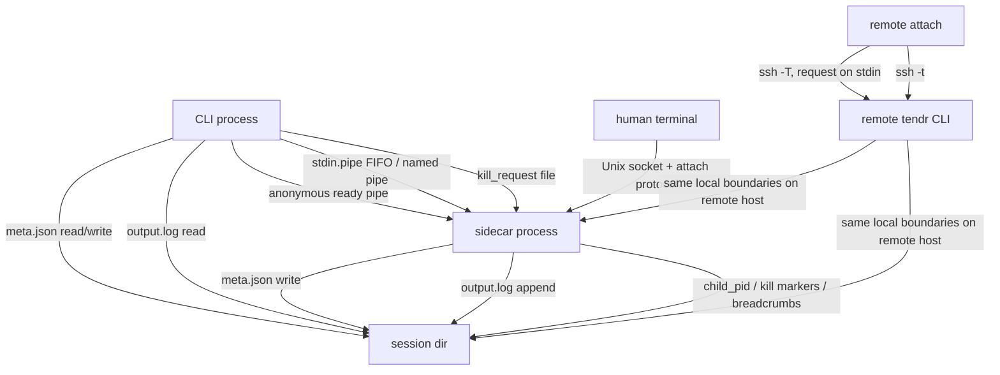

# Transport Boundaries

This file lists every place where bytes cross a process boundary. Everything
else is in-process logic.



## Boundary inventory

| Boundary | Who uses it | What it carries |
|---|---|---|
| Ready pipe | Created by `start`; used once at sidecar startup. | `OK:<meta>` or `ERROR:<message>`. |
| `stdin.pipe` | Created with `--stdin`. Used by `push` to a pipe session, and by `exec` to send framed commands. A PTY `push` uses the attach socket. | Raw input bytes. |
| `kill_request` | Written by `kill`; read by the sidecar's kill watcher. | `force` and `run_id`; a request for another run is ignored. |
| `output.log` | Appended by the sidecar, `wrap` and `exec`. Read by `log`, `watch`, `exec` and `events --include-logs`. | JSONL lines tagged `O`, `E` or `A`. |
| `events/*.jsonl` | Appended by the sidecar, `emit`, `exec`, `wrap` and reconciliation. Read by `events`, `watch` and `query`. | Event envelopes ([07-event-protocol.md](07-event-protocol.md)). |
| PTY attach socket | Unix socket under `~/.tendr/sockets`, found through `a.sock.path`. | The attach protocol: `MSG_HELLO`, `MSG_DATA`, `MSG_RESIZE`, `MSG_DETACH` and others ([04-pty-lane.md](04-pty-lane.md)). |
| SSH | `--host` on a remote-capable command. | One request as data on ssh stdin, run by the remote tendr; `attach` sends a command line of plain names instead. |

## SSH transport

`--host` runs the same tendr command on the remote host. It adds no event
model or session store of its own.

| Over `--host` | Commands |
|---|---|
| supported | `start`, `status`, `list`, `log`, `push`, `kill`, `wait`, `watch`, `attach`, `exec` |
| local-only, exit 2 with a ready-to-paste `ssh <host> 'tendr …'` command, quoted for a POSIX shell and labelled so | `run`, `wrap`, `prune`, `query`, `guide`, `skill` |
| local-only, exit 1 with the list of supported commands | `emit`, `events` |

`wrap` also needs the supervised-process environment, so it only works
inside a tendr-supervised process on the target host.

The remote command line is constant, so no value the user typed reaches the
remote login shell, whether that is bash, `cmd.exe` or PowerShell:

| Operations | Remote command line | Request |
|---|---|---|
| `start`, `status`, `list`, `log`, `push`, `kill`, `wait`, `watch` | `ssh -T … tendr [--hello] --exit-trailer _remote` | The remote frame on ssh stdin |
| `exec` | `ssh -T … tendr [--hello] --exit-trailer exec --frame-from-stdin` | The exec frame on ssh stdin |
| `attach` | `ssh -t … tendr attach <name> [--namespace <ns>] [--takeover] [--escape none]` | The command line itself |

### The remote frame

`src/remote_frame.rs` carries one `RemoteOperation` (`src/remote_op.rs`) to
the hidden `tendr _remote` entry point. On ssh stdin:

```text
4-byte big-endian length N | N bytes of UTF-8 JSON | push only: the body, to EOF
```

The JSON is the request under a version:

```json
{"v": 1, "op": "status", "params": {"session": "build", "namespace": null}}
```

- `op` is `start`, `status`, `list`, `log`, `push`, `kill`, `wait` or
  `watch`; `params` holds what the user typed, unresolved. Namespace
  defaults and `--after` run IDs resolve on the remote host.
- The client refuses, with exit 2 and before ssh starts, a `--cwd` that is not
  UTF-8 (JSON carries UTF-8 only) and a header over 1 MiB.
- The client closes ssh stdin after the header, except for `push`: it then
  copies local stdin as it arrives, to its end. The remote reads the body
  through the same buffered stdin as the header, so no byte is lost.
- `_remote` reads exactly 4 + N bytes, refuses N over 1 MiB before reading
  the JSON, and checks the version, the operation and the values (names,
  `KEY=VALUE` entries, a non-empty command, flags that need another) before
  anything runs. A refused request prints `tendr _remote: <why>` and exits 2.
  Unknown JSON fields are ignored; an unknown `v` or `op` is refused.
- Otherwise the request runs as the same command typed on the remote host:
  stdout, stderr and exit code are the local command's, and `log -f` and
  `watch` stream.
- A remote tendr from before the frame fails with clap's
  `unrecognized subcommand '_remote'` (or `unexpected argument
  '--exit-trailer' found`, or, older still, the same for `--hello`). The
  client passes that on and adds that the remote tendr is too old for this
  client and which version to upgrade it to. Old clients still work against
  a new remote tendr.

### The exit trailer

Under a PowerShell login shell (Windows PowerShell 5.1 and PowerShell 7),
ssh's exit status collapses to 0 or 1; `cmd.exe` and POSIX shells pass the
code on. Stdin and stderr pass through all three exactly, so the code also
travels on stderr:

- `tendr --exit-trailer <command>` (`src/main.rs`) runs the same command line
  without the flag as a child with the same stdin, stdout and stderr, then
  writes `tendr-exit <code>` as the last stderr line and exits with the
  code. The wrapper covers every exit path, panics included, and never reads
  stdin; the child writes the hello. The flag is accepted only before the
  subcommand. A child killed by a signal gets no trailer.
- The client's stderr relay (`src/ssh.rs`) holds back only a line that may be
  the trailer, and only while it is the last thing that arrived. A
  `tendr-exit <int>` line followed by anything else is the command's own
  output and is passed on. At end of stream a held trailer is dropped and its
  code becomes the call's exit code.
- Without a trailer the client falls back to ssh's status. ssh's 255 without
  a trailer is a connection failure; a trailer of 255 is the remote's code.

`attach` needs a remote terminal, so it stays on `ssh -t` with a rebuilt
command line until the attach bridge lands
([plan](../plans/active/01_remote-frame-transport.md)). Its session and
namespace must match `[A-Za-z][A-Za-z0-9_-]{0,254}`, and its flag values
are fixed tokens; any other name exits 2 before ssh starts. A name starts
with a letter because PowerShell reads a bare token that starts with a digit
as a number (`0x1F` arrives as `31`).

### Remote `exec`

`exec` sends the whole request as one JSON frame over ssh stdin to a remote
`tendr exec --frame-from-stdin`. Everything else runs on the remote host
exactly as for a local exec: the FIFO, `exec.lock`, the `output.log` scan, and
`exec-results/<token>.json`. Only the request frame and the JSON result cross
the SSH boundary.

### Connect deadline

The connect deadline (`src/ssh.rs`) catches an SSH connection that stalls
before the remote tendr starts.

- Every call except `attach` runs the remote as `tendr --hello …`. Its first
  stderr line is `ssh::HELLO_LINE` (`tendr-hello 1`).
- The local end reads stderr, drops the hello line, and passes the rest
  through.
- If the hello has not arrived within `TENDR_SSH_CONNECT_TIMEOUT` seconds
  (default 30), tendr sends ssh SIGTERM, then SIGKILL one second later. The
  call exits 82.
- After the hello there is no deadline, so `wait` and `log -f` run as long
  as they need.
- ssh's own `ConnectTimeout` ends at key exchange. Authentication can still
  stall afterwards; for example, a lapsed Tailscale SSH check-mode approval
  waits about 30 minutes with no output.
- The marker comes from the remote tendr, not from ssh's log. ssh's log is
  unreliable across ControlMaster reuse and OpenSSH versions.
- `attach` gets no deadline, because its stderr shares the terminal.
- `TENDR_SSH_CONNECT_TIMEOUT=0` sends no `--hello`. Stderr is still relayed,
  for the exit trailer and an old remote's parse error.
- A remote tendr that rejects `_remote`, `--hello` or `--exit-trailer` fails
  with clap's error (exit 2, or 1 under PowerShell); the local end adds what
  to upgrade.
- stdout stays inherited while a thread relays stderr. So the order between
  the two streams is not exact; each stream keeps its own order.

### What ssh is given

- Every call but `attach` gives ssh tendr's stdout. Its stdin is tendr's
  own for `exec --frame-from-stdin`, otherwise a pipe tendr writes the
  request (and a `push` body) to. Its stderr is a pipe tendr relays.
  `attach` gives ssh all three of tendr's streams.
- No other stream of tendr's reaches ssh. Windows hands a child every
  inheritable handle in its parent, and the std handles tendr inherited are
  inheritable, so `spawn` in `src/ssh.rs` clears `HANDLE_FLAG_INHERIT` on
  them first. The streams tendr does give ssh are unaffected: std passes
  each as an inheritable duplicate. Everything a `--host` call opens itself
  is already non-inheritable. Other inheritable handles the caller leaked into
  tendr (often the caller's own stdio) still pass through, as a leaked fd
  does on Unix; only an explicit handle list
  (`PROC_THREAD_ATTRIBUTE_HANDLE_LIST`) would stop them. That needs a
  hand-written `CreateProcessW` that also does what the ssh spawn takes
  from `std::process::Command` (PATH search, piped stdio, `Child` for the
  deadline's wait and kill), since std's process-attribute API is unstable;
  the sidecar's raw spawn (`spawn_sidecar_raw`) does none of that.
- What ssh hands its ProxyCommand is up to ssh. Win32-OpenSSH before its
  handle allow-list (PowerShell/openssh-portable#852, September 2026) passes
  on every inheritable handle, its own stdout included.

### Windows login shells

Windows OpenSSH hands the remote command to cmd.exe by default, or to the
shell set in `HKLM:\SOFTWARE\OpenSSH\DefaultShell`. CI's `windows-openssh` job
runs `tests/cli_remote_windows_ssh.rs` on the x64 and ARM64 lanes against a
real sshd on the runner, once each under cmd.exe, Windows PowerShell 5.1 and
pwsh 7. The tests send session names, child argv, `--cwd`, `--env` values,
`log --since`, `push` bytes and an `exec` payload full of shell syntax, and
check that the remote tendr received them verbatim, that the shell ran none of
them, and that exit codes (0, 1, 2 for a refused request, 42) come back
exactly. They also check that a run outlives the ssh session that started it,
and that a Windows PowerShell session sees none of the pwsh 7 module
directories a pwsh 7 login shell passes down
(guide, [PowerShell](../guide.md#powershell)).
Locally they are opt-in; the file's header lists the setup.

## In-process logic

These never cross a boundary:

- `Meta` transition methods
- launch-spec hashing and idempotency checks
- `watch` event formatting, once state and log lines are read
- annotation payload construction before append

## Execution environments

Tendr's IPC assumes one shared filesystem and one user ID, in one trust
domain. When sessions run in containers, VMs or other hosts, the question is
where the session dir lives.

| Axis | Tendr's position |
|------|-------------------|
| **Identity** | `ProcessIdentity { pid, start_time_ns }`. No container or VM ID. |
| **Lifecycle** | The `RunStatus` state machine. Container states such as `paused` or `restarting` are out of scope. |
| **Authority** | The kernel (process tables, signals), not a container daemon. |
| **Boundaries** | Implicit: whatever process tree the sidecar can see. |
| **IPC** | Shared filesystem and local sockets. Works inside any boundary that provides both. |

In practice:

- **Tendr inside a container** works best for persistent shells and REPLs.
  Tendr owns the child directly, and all IPC works normally.
- **Tendr outside, supervising `docker run ...`** works for foreground
  container jobs. Tendr supervises the `docker` client process, not the
  container. Do not use it with `docker run -d`: tendr would supervise the
  short-lived client and lose the real workload.
- **Sharing one session between containers** breaks rule 2, one authority
  per fact ([../design.md](../design.md#2-one-authority-per-fact)). A shared
  volume for artifacts is fine. Several tendr instances writing the same
  session state is not.

Tendr does not manage containers, VMs or orchestrators. The `--boundary`
field on `start` records where a session runs; it does not manage that
environment. Lifecycle events copy it into `run.starting` and `run.started`
only. See the [guide](../guide.md#record-where-a-session-runs---boundary).
